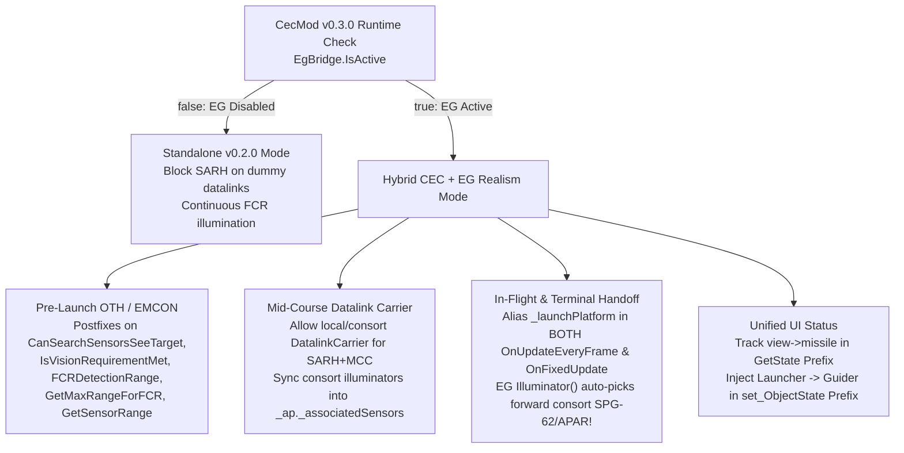

# Implementation Plan: `CecMod` v0.3.0 + `ExtendedGuidance.dll` Compatibility Bridge

> [!IMPORTANT]
> **Goal for Next Coding Session**: Allow `CecMod` (`com.cecmod.seapower`) and Anchor Chain's `ExtendedGuidance` (`euromod.extended-guidance` v0.10.27, Workshop ID `3784474738`) to run **simultaneously** with full realism—preserving `ExtendedGuidance` seeker/clutter/time-shared terminal illumination physics while enabling `CecMod` multi-ship & AWACS Cooperative Engagement Capability (OTH, EMCON, and mid-flight / terminal handoff). `CecMod` must also continue working identically when `ExtendedGuidance` is disabled.

---

## 1. Reverse-Engineered Architecture of `ExtendedGuidance.dll` (v0.10.27)

- **Plugin Type**: AnchorChain submod (`[ACPlugin("euromod.extended-guidance", "ExtendedGuidance", "0.10.27")]` in `G:\Program Files (x86)\Steam\steamapps\workshop\content\1286220\3784474738\ExtendedGuidance.dll`).
- **Harmony Instance ID**: `"euromod.extended-guidance"` — installs most prefixes at **`Priority.High` (`priority = 800`)**, and wraps startup in `StartGuarded()` (calls `val.UnpatchSelf()` if initialization fails).
- **Load Order Timing**: AnchorChain loads submods *after* BepInEx `Awake()` depending on scene/menu lifecycle, and users can toggle `euromod.extended-guidance` via `ACSubmods.PreferenceStore`. Therefore, **detection MUST be lazy/dynamic**, not cached once in `CecPlugin.Awake()`.

### Key `ExtendedGuidance` Methods & Hooks That Interact With `CecMod`

| Game Method | `ExtendedGuidance` Hook (`priority = 800`) | Behavior in `ExtendedGuidance` | Conflict with `CecMod` v0.2.0 |
|---|---|---|---|
| `SensorSystem.CanGuideAmmo(AmmunitionParameters)` | Prefix `Hooks.TerminalGuideAmmo` | Returns `__result = true` (skipping vanilla) when `Runtime.PermitTerminalGuidance` allows a dummy `DatalinkCarrier` (e.g., `eu_AEGIS_BL9`) or terminal illuminator. | `CecMod`'s `CanGuideAmmo_Postfix` runs *after* Prefix and forces `false` on synthetic datalinks for SARH, breaking `ExtendedGuidance`'s mid-course datalink carrier (`PreferDatalink`). |
| `WeaponBase.ActivateNonLaserGuidanceSystem()` | Prefix `Hooks.PreferDatalink` | For SARH/ARH+Datalink missiles, binds `_guidingRadarSystem` to an available `DatalinkCarrier` in `_weaponSystem._vwp._associatedSensors` and skips vanilla. | `CecMod`'s `ActivateNonLaserGuidanceSystem_Postfix` sees a local dummy sensor that "cannot see" OTH or has `CanSensorGuideAmmo == false` and yanks the missile off the carrier prematurely. |
| `Missile.CheckRadioConnection()` | Prefix `Hooks.RadioConnection` | Always skips vanilla (`return false`) for EG-owned missiles; sets `ConnectionLost.Value = !state.LinkAvailable` via `Runtime.RefreshExternal`. | `CecMod` only aliased `_launchPlatform = guider` around `Missile.OnUpdateEveryFrame`, not `Missile.OnFixedUpdate`. |
| `Missile.OnFixedUpdate()` | Prefix/Hook `Hooks.Fixed` | Runs `Runtime.RefreshExternal(state, now)` which calls `ReadNativeContact(missile._launchPlatform, state.Intended, missile._guidingRadarSystem, ...)` and `Illuminator(state, now)`. | If `_launchPlatform` is OTH, in EMCON, or sunk while a consort/AWACS guides, `ReadNativeContact(missile._launchPlatform, ...)` checks the wrong unit unless `_launchPlatform` is also aliased in `OnFixedUpdate`. |
| `Runtime.Illuminator(State s, double now)` *(internal)* | Called during terminal SARH approach (`TerminalIlluminationDue`) | Reserves a real CW/IWI illuminator dish ONLY for the final seconds before impact by scanning **`missile._ap._associatedSensors`** (NOT `_weaponSystem._vwp._associatedSensors`!). | `CecMod` v0.2.0 only injects consort FCRs into `_weaponSystem._vwp._associatedSensors`. Syncing consort FCRs into `missile._ap._associatedSensors` unlocks **automatic cross-ship delayed terminal illumination**! |
| `WeaponSystem.FCRDetectionRange(...)` | Prefix `Hooks.FcrRange` | Loops `weapon._vwp._associatedSensors` calling `Runtime.RadarRange(val, target, options)`. Skips vanilla. | Works with `CecMod`'s injected `_associatedSensors` *once* `CanGuideAmmo` and OTH horizon checks cooperate, plus needs a Postfix fallback for AWACS/OTH. |
| `WeaponSystem.CanSearchSensorsSeeTarget(...)` & `WeaponSystem.IsVisionRequirementMet(...)` | Prefixes `Hooks.LauncherSearchVision` & `Hooks.LauncherVision` | Evaluates `Runtime.LauncherObservation` using own-ship sensors (`weapon._baseObject._obp._sensorSystems` or explicit `AssociatedSearchSensors`), returning `false` in EMCON or OTH. | `IsVisionRequirementMet` already has a `CecMod` Postfix, business logic also calls `CanSearchSensorsSeeTarget` directly via `FcrAcquisitionAdapter` transpilers! Adding a Postfix on `CanSearchSensorsSeeTarget` fixes AI/player OTH & EMCON acquisition under EG. |
| `ObjectMissileControlViewModel.GetState(Missile, SensorSystemLaserDesignator)` | Prefix `Hooks.MissileRow` + 0.25s timer `RefreshMissileRows` | Skips vanilla `GoodConnection` and writes custom seeker telemetry directly to `view.ObjectState = text` every 0.25s. | `CecMod`'s `DatalinkUiPatch` on `GoodConnection` never runs when EG owns the missile row. |

---

## 2. Architecture of the Bridge (`CecMod` v0.3.0)

---

## 3. Step-by-Step File Plan for the Next Session

### Step 1: Create `CecMod/EgBridge.cs` (Zero Hard Dependency Reflection Bridge)
 Do **not** add a compile-time DLL reference to `ExtendedGuidance.dll` in `CecMod.csproj` so `CecMod` builds and runs cleanly with or without Workshop `3784474738` installed.

Implement `internal static class EgBridge`:
1. **`IsActive` check (fast, cached per 2 seconds or on assembly load)**:
   - Lookup type `ExtendedGuidance.MissileStatusApi` in loaded assemblies (`AppDomain.CurrentDomain.GetAssemblies()`), bind a `Func<bool>` or `FieldInfo` to `public/internal static bool Active`!
   - Fallback check: `Harmony.HasAnyPatches("euromod.extended-guidance")`.
2. **Helper accessors into `ExtendedGuidance.Runtime` (bound lazily via `Delegate.CreateDelegate` / `AccessTools`)**:
   - `bool IsDatalinkCarrier(SensorSystemRadar radar)` -> calls `ExtendedGuidance.Runtime.DatalinkCarrier(SensorSystemRadar)` (or checks `CecCapability.IsSyntheticDatalinkSensor(radar) || radar._radar._rp._datalinkGuidance`).
   - `SensorSystemRadar GetActiveEgIlluminator(Missile m)` -> reads `ExtendedGuidance.Runtime.States[m].Illuminator` (if present and non-null) so `DatalinkUiPatch` and `HandoffPatch` know when `ExtendedGuidance` has already reserved a consort illuminator (`s.Illuminator`) while `_guidingRadarSystem` is still pointing at the mid-course `DatalinkCarrier`!
   - `bool IsWaitingForTerminalIllumination(Missile m)` -> true when `IsActive` is true, `m._ap._guidanceType == SemiActiveRadarHoming`, `m._ap._midCourseCorrection.IsDatalink`, `IsDatalinkCarrier(m._guidingRadarSystem)` is true, and `!m.ConnectionLost.Value`.

---

### Step 2: Update [`CecCapability.cs`](file:///G:/Project/CEC_mod/CecMod/CecCapability.cs)
1. **Update `CanSensorGuideAmmo(SensorSystem sensor, AmmunitionParameters ap)`**:
   - Currently, when `ap._guidanceType == SemiActiveRadarHoming` and `IsSyntheticDatalinkSensor(r)` is true, `CanSensorGuideAmmo` returns `false`.
   - **New rule when `EgBridge.IsActive` is `true`**:
     - If `ap._guidanceType == SemiActiveRadarHoming && ap._midCourseCorrection.IsDatalink && IsSyntheticDatalinkSensor(r)`:
       - Allow it (`return true`) **ONLY IF** the synthetic datalink sensor belongs to the **same CEC doctrinal network** (`GetPlatformNetwork(r._baseObject)`) as the missile/launcher! (This restores `ExtendedGuidance`'s `eu_AEGIS_BL9` mid-course carrier for `SM-2` when EG is enabled, while still keeping it blocked when EG is disabled!)
2. **Add `SyncConsortIlluminatorsToAmmo(WeaponSystem ws, AmmunitionParameters ap)`**:
   - Remember: `ExtendedGuidance.Runtime.Illuminator(State s, double now)` iterates **`missile._ap._associatedSensors`**, NOT `ws._vwp._associatedSensors`!
   - Wait — be very careful! Is `missile._ap` a **shared** `AmmunitionParameters` singleton across ALL ships (including enemy ships!) carrying that ammo, or per-vessel?
   - **CRITICAL CHECK FOR CODING SESSION**: Before mutating `missile._ap._associatedSensors`, verify in decompiled `WeaponBase.cs` / `AmmunitionParameters.cs` how `_ap._associatedSensors` is populated!
     - If `_ap` is shared across ships/taskforces, **DO NOT permanently append Ship A's sensors to `_ap._associatedSensors`** without scoping or checking `r._baseObject._taskforce == missile._taskforce`! Even better: check where `_ap._associatedSensors` is set in `Seapower-Scripts.dll`. If `_ap` is per-launcher or if `ExtendedGuidance` only checks `_ap._associatedSensors`, we can either clone/scope or swap `_ap._associatedSensors` during `OnFixedUpdate` for that missile's taskforce! **Verify `_ap._associatedSensors` ownership in `Seapower-Scripts.dll` first!**

---

### Step 3: Update [`Patches/RemoteEngagementPatch.cs`](file:///G:/Project/CEC_mod/CecMod/Patches/RemoteEngagementPatch.cs)
1. **Keep `CanGuideAmmo_Postfix`**, but pass `bool vanillaOrEgResult = __result`:
   - In `CanGuideAmmo_Postfix(SensorSystem __instance, AmmunitionParameters ap, ref bool __result)`:
     - When `!__result`, don't turn `false` into `true` unless `CecCapability` explicitly grants AWACS/MFR datalink guidance; when `__result` is `true` (e.g., set by `ExtendedGuidance.Hooks.TerminalGuideAmmo`), run `CecCapability.CanSensorGuideAmmo(__instance, ap, egActive: EgBridge.IsActive)`.
2. **Add Postfix on `WeaponSystem.CanSearchSensorsSeeTarget`**:
   - Signature in `Seapower-Scripts.dll`:
     `public bool CanSearchSensorsSeeTarget(ObjectBase targetObject, out float guidanceSystemPenalty, ObjectBase.SensorRangeOptions options = default)`
   - Why: `ExtendedGuidance` patches `CanSearchSensorsSeeTarget` at `priority = 800` (`Hooks.LauncherSearchVision`) AND transpiles `ObjectBase.HandleEngageTasks` (`FcrAcquisitionAdapter.TaskVisibility`) to call it. In EMCON or OTH, `ExtendedGuidance` sets `__result = false`.
   - Postfix logic: If `!__result && targetObject != null && targetObject.isAirTarget()` and `CecCapability.HasCooperativeAirTrack(__instance._baseObject, targetObject, options)` is true, set `__result = true` and `guidanceSystemPenalty = 0f`.
3. **Add Postfix on `WeaponSystem.FCRDetectionRange`**:
   - Signature in `Seapower-Scripts.dll`:
     `public float FCRDetectionRange(ObjectBase targetObject, Ammunition ammo, out ObjectBase.EngagementIssue? issue, ObjectBase.SensorRangeOptions options = default)`
   - Why: `ExtendedGuidance` patches `FCRDetectionRange` (`Hooks.FcrRange`) and skips vanilla.
   - Postfix logic: If `!HandoffPatch.IsCheckingRadioConnection && targetObject != null && ammo?._ap != null`, when `__result < distToTarget` and `CecCapability.HasRemoteFcrCoverage(__instance._baseObject, ammo._ap, targetObject)` is true, lift `__result` to `Mathf.Min(ammo._ap._launchRangesInUnity.y, distToTarget + 50f)` and set `issue = null`.

---

### Step 4: Update [`Patches/LaunchTimeCecPatch.cs`](file:///G:/Project/CEC_mod/CecMod/Patches/LaunchTimeCecPatch.cs)
1. In `ActivateNonLaserGuidanceSystem_Postfix(WeaponBase __instance)`:
   - When `EgBridge.IsActive` is `true` and `current != null`:
     - If `EgBridge.IsDatalinkCarrier(current)` is `true` (meaning `Hooks.PreferDatalink` bound the missile to own-ship `eu_AEGIS_BL9` or similar mid-course carrier):
       - Check whether `current._baseObject` (the launcher) or its CEC network has a valid mid-course datalink radio path to the missile (`!current.Inoperable.Value && current.IsOn.Value`).
       - If the launcher is **NOT** in EMCON (or `current` is an active passive/datalink terminal that didn't break EMCON), **do NOT yank the missile off `current`** just because `RadarCanSee(current, target)` is OTH! Remember: a `DatalinkCarrier` only needs LOS to the **missile** (mode 3), while the target track comes from the plotting table / AWACS / forward ship, and terminal illumination will be reserved later by `Illuminator(s, now)` or `HandoffPatch`!
       - Only rebind `current` at launch if `current` was auto-enabled from EMCON or has no radio LOS to the missile.

---

### Step 5: Update [`Patches/HandoffPatch.cs`](file:///G:/Project/CEC_mod/CecMod/Patches/HandoffPatch.cs)
1. **Also patch `Missile.OnFixedUpdate` (Prefix + Postfix + Finalizer)**:
   - Why: When `ExtendedGuidance` is active, `Hooks.Fixed` runs on `Missile.OnFixedUpdate` and calls `Runtime.RefreshExternal`, which passes `missile._launchPlatform` into `ReadNativeContact(missile._launchPlatform, state.Intended, missile._guidingRadarSystem, ...)`.
   - Solution: Use the exact same Prefix/Finalizer pattern as `OnUpdateEveryFrame`:
     - Determine active guider platform: `ObjectBase guiderPlatform = (EgBridge.GetActiveEgIlluminator(__instance) ?? __instance._guidingRadarSystem)?._baseObject`.
     - If `guiderPlatform != null && !guiderPlatform.IsDestroyed && guiderPlatform != __instance._launchPlatform`, temporarily swap `__instance._launchPlatform = guiderPlatform` during `OnFixedUpdate` and restore in `Postfix`/`Finalizer`!
     - **Important**: Note that `Taskforce.PlottingTable` contacts are shared across the taskforce, AND if the original `_launchPlatform` was **sunk/destroyed**, aliasing `_launchPlatform = guiderPlatform` during `OnFixedUpdate` keeps `ReadNativeContact` alive on the consort/AWACS instead of failing on a dead `_launchPlatform`!
2. **Terminal Illumination Handoff Support under `ExtendedGuidance`**:
   - In `OnUpdateEveryFrame_Postfix`:
     - Do **not** treat `EgBridge.IsWaitingForTerminalIllumination(__instance)` as a broken radar!
     - However, when a SARH missile on a `DatalinkCarrier` enters terminal range (`TerminalApproach` or distance to target `<= max(_seekerPassiveRange, _terminalApproachDist)`) AND own-ship illuminators cannot see the target (OTH / horizon-masked / channels full / sunk), if `EgBridge.GetActiveEgIlluminator(__instance) == null`, `HandoffPatch` can hand `_guidingRadarSystem` directly to `CecCapability.FindHandoffRadar(__instance)` (a forward consort's `SPG-62` / `APAR` / `Top Dome` / `Type 346`), which `ExtendedGuidance.Runtime.Illuminator()` immediately adopts on lines 256–265 (`if (CanIlluminate(guidingRadarSystem) ... s.Illuminator = guidingRadarSystem; return guidingRadarSystem;`)!
     - Look how clean that is: **we don't even have to mutate shared `_ap._associatedSensors` if `HandoffPatch` hands `_guidingRadarSystem` to the forward consort illuminator as soon as terminal illumination is due and `EgBridge.GetActiveEgIlluminator(m) == null`!**

---

### Step 6: Update [`Patches/DatalinkUiPatch.cs`](file:///G:/Project/CEC_mod/CecMod/Patches/DatalinkUiPatch.cs)
Make `Launcher -> Guider` display in **both** vanilla mode and `ExtendedGuidance` mode:
1. Keep a `ConditionalWeakTable<ObjectMissileControlViewModel, Missile>` populated by a lightweight **Prefix** on `ObjectMissileControlViewModel.GetState(Missile missile, SensorSystemLaserDesignator designator)` (`Priority.First`, `priority = 900`, before `ExtendedGuidance`'s `priority = 800` Prefix!).
2. Patch `ObjectMissileControlViewModel.ObjectState` **Setter** (`[HarmonyPatch(typeof(ObjectMissileControlViewModel), nameof(ObjectMissileControlViewModel.ObjectState), MethodType.Setter)]`, Prefix modifying `ref string value`):
   - Look up `Missile m` for `__instance` in the `ConditionalWeakTable`.
   - Check both `SensorSystemRadar activeIllum = EgBridge.GetActiveEgIlluminator(m)` and `m._guidingRadarSystem`.
   - Determine `guider = (activeIllum ?? m._guidingRadarSystem)?._baseObject`.
   - If `guider != null && guider != m._launchPlatform`:
     - In vanilla format (where `value` contains `launcherName` or `"Nibiru"`), replace with `$"{launcherLabel} -> {guiderName}"` (avoiding double-injection if already present).
     - In `ExtendedGuidance` format (where `WriteMissileRow` writes e.g. `"SARH: midcourse DL<LineBreak/>Target: 104"` without unit names, refreshed every 0.25s by `RefreshMissileRows`), insert `<LineBreak/>CEC: {launcherLabel} -> {guiderName}` before `<LineBreak/>Target:` / `<LineBreak/>No target info`!

---

## 4. Verification Checklist for Next Session

1. **Build Verification**:
   - `dotnet build G:\Project\CEC_mod\CecMod\CecMod.csproj -c Release` -> **0 warnings, 0 errors**, with **no** reference to `ExtendedGuidance.dll` in `CecMod.csproj`.
   - Reflection script verifying all Harmony targets resolve unambiguously against `Seapower-Scripts.dll` (0.8.7).
2. **Test Case A — `ExtendedGuidance` OFF**:
   - Euromod Burke (`eu_AEGIS_BL9`) cannot fire 16 SARH `SM-2`s without `SPG-62` channels; AWACS OTH `SM-6` launch works; consort `SM-2` illumination handoff works; UI shows `Ship A -> Ship B`.
3. **Test Case B — `ExtendedGuidance` ON (via Anchor Chain Pack)**:
   - Own-ship Aegis Burke fires >4 `SM-2`s using `eu_AEGIS_BL9` mid-course carrier + delayed `SPG-62` terminal illumination (`ExtendedGuidance` TSH works!).
   - Rear Burke in EMCON or behind horizon fires `SM-6` / `SM-2` on E-2D Hawkeye or forward picket Burke track (`Engage-on-Remote` works!).
   - Forward picket Burke illuminates the low-altitude target during final terminal approach when rear Burke is horizon-masked (`HandoffPatch` -> `Runtime.Illuminator` adoption works!).
   - Sinking the launching ship mid-flight transfers guidance cleanly to the consort/AWACS without `RefreshExternal` dropping the link.
   - Bottom-bar missile status shows both `ExtendedGuidance` seeker state AND `CEC: Launcher -> Guider`.
