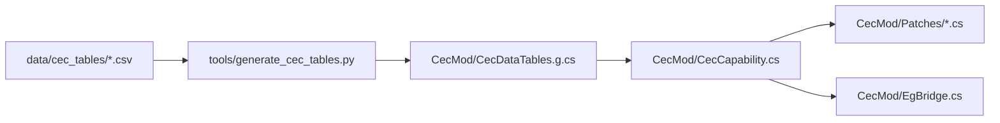

# Task Specification: Real-World Multi-Tier CEC & Datalink Restructure

> **Purpose**: This document is a complete, self-contained implementation specification for restructuring **Sea Power CEC (`CecMod`)** from the legacy v0.3.0 broad-network system into a verified, real-world multi-tier naval and air combat datalink architecture.
> **Target Audience**: AI coding agent or software engineer executing this task in a new session. Read this entire document before writing any code.

---

## 1. Executive Summary & Context

### 1.1 The Problem in CecMod v0.3.0
In `CecMod` v0.3.0, any vessel or aircraft in a taskforce with `HasDataLink = True` on any search radar is treated as fully CEC-capable. Because vanilla *Sea Power* sets `HasDataLink = True` on almost all search radars, 1960s–1980s Cold War combatants (*Knox*, *Oliver Hazard Perry*, *Spruance*, early *Adams*, *Kirov*, *Udaloy*, *Sovremenny*) and legacy munitions (`RIM-66A` SM-1MR, `RIM-7E` Sea Sparrow, `SA-N-4` 9M33) are granted full Over-The-Horizon (OTH) blind-fire capability, Launch-on-Remote, and mid-flight handoffs as if they were modern USN NIFC-CA or PLAN AESA battle networks.

### 1.2 The Solution
Restructure the mod into a strict, layered qualification engine based on verified historical and doctrinal data from the project CSV tables:
1. **4-Tier Capability Model**:
   * **Tier 1 (Full CEC / NIFC-CA / PLAN "A-Shoot-B-Guide")**: Blind Launch-on-Remote (OTH/EMCON), third-party mid-course & terminal handoff, composite track sharing.
   * **Tier 2 (Mid-Course Cooperative / Link 16 / HN-900 / Fort-TVM)**: **No Launch-on-Remote** (shooter requires local radar tracking to launch); supports mid-course handoff and consort track rescue if shooter enters EMCON, is jammed, or loses radar sight.
   * **Tier 3 (Local Guidance Only / Link 11 / Track Relay)**: **No Launch-on-Remote, no mid-course handoffs**. Pure local guidance (missile guided exclusively by launching ship's own FCR). Datalink is track relay only.
   * **Tier 0 (Standalone)**: No datalink, IR / unguided munitions.
2. **10x10 Pairwise Datalink Compatibility Matrix**:
   Capabilities between any two platforms are determined by their datalink standard intersection (`USG-2/3 CEC`, `TTNT`, `Link 16`, `Link 11`, `IFDL`, `MADL`, `JSIDLS`, `HN-900`, `RuNaval / Fort-TVM`, `TKS-2 / APD-518`).
3. **Munition Tier Gating**:
   * Tier 1 ARH missiles (`SM-6`, `AIM-120D`, `PL-15`, `Aster 30`, `Meteor`) support full blind Launch-on-Remote.
   * Tier 2 SARH+DL missiles (`SM-2MR`, `48N6`, `HQ-16`, `ESSM Blk 1`) support mid-course handoff, and can only be launched remotely if a forward consort with a compatible physical CW illuminator has line of sight to the target (Forward Pass / Project Mountain Top).
   * Tier 3 legacy missiles (`SM-1MR`, `AIM-7`, `Sea Sparrow`, `SA-N-4`, `RIM-24`) are strictly locked to local launcher guidance.
4. **Compiled In-Memory Static Lookup Tables**:
   Generated directly from the spreadsheet CSVs via a Python tool into $O(1)$, zero-allocation C# static tables (`CecDataTables.g.cs`).

---

## 2. Reference Files & Architecture Links

### 2.1 Project Source Files
* Project root: `G:\Project\CEC_mod\`
* Plugin source: `CecMod/` (`Plugin.cs`, `CecCapability.cs`, `EgBridge.cs`, `AnchorChainEntry.cs`, `CecMod.csproj`)
* Harmony patches: `CecMod/Patches/` (`RemoteEngagementPatch.cs`, `LaunchTimeCecPatch.cs`, `HandoffPatch.cs`, `DatalinkUiPatch.cs`)

### 2.2 Verified Data Tables (`data/cec_tables/`)
* `00_Glossary.csv`: Acronyms and technical definitions.
* `01_Core_CEC_matrix.csv`: 4-Tier capability rules.
* `02_Datalink_Compatibility_Matrix.csv`: 10x10 pairwise protocol interaction matrix.
* `03_Ships.csv`: 344 ships with `EntityId`, `CecTier`, `DataLinkType`, `GuidanceFamily`, `LinkedSensors`, `LinkedWeapons`.
* `04_Aircraft.csv`: 132 aircraft with `EntityId`, `CecTier`, `DataLinkType`, `GuidanceFamily`, `LinkedSensors`.
* `05_Radars.csv`: 287 radars with `EntityId`, `CecTier`, `DataLinkType`, `GuidanceFamily`, `MaxRange`, `MFR`, `AWACS`.
* `06_Missiles.csv`: 182 missiles with `EntityId`, `CecTier`, `DataLinkType`, `GuidanceFamily` (ARH/SARH/IR/Command).

### 2.3 Decompiled Game Code References (`scratch/`)
* `scratch/AttackingState.cs`: Hover UI, weapon range ring computation (`UpdateDisplayedRange`, `Source.GetMaxEngagementRanges`).
* `scratch/ObjectBase.cs`: Core unit class (`GetMaxRangeForFCR`, `GetSensorRange`, `GetLocalAirTargetVisibilityRange`, `Formation`).
* `scratch/WeaponSystem.cs`: Launcher weapon tracking (`CheckExternalRadarGuidance`, `CheckTargetIsDetectableByFCR`, `FCRDetectionRange`, `CanSearchSensorsSeeTarget`).
* `scratch/WeaponSystemLauncher.cs`: Pre-launch guidance and salvo loops (`activatePreLaunchGuidance`).
* `scratch/Missile.cs`: In-flight missile loop (`OnUpdateEveryFrame`, `OnFixedUpdate`, `CheckRadioConnection`).
* `scratch/WeaponBase.cs`: Ammunition base (`activateGuidingSystem`, `ActivateNonLaserGuidanceSystem`).
* `scratch/RadarCalculator.cs`: 4/3-Earth horizon math (`getRadarHorizon`).
* `scratch/RadarParameters.cs`: Radar sensor definitions from `sensors.ini` (`_maxRange`, `_maxAltitude`, `_hasDataLink`).
* `scratch/UnitFormation.cs`: Tactical formations and aircraft flight leadership (`_leaderStation`, `Stations`).
* `scratch/Aircraft.cs`: Aircraft flight group properties (`ActiveFormationLeader`, `Formation`).

---

## 3. Approved Technical Decisions & Tradeoffs

The following design decisions were evaluated and explicitly approved:

### Decision 1: Strict Tier 3 Default for Unindexed Units
* **Rule**: Any ship, aircraft, radar, or weapon not present in the verified CSV dataset defaults strictly to **Tier 3 (Local FCR only / Link 11)**.
* **Rationale**: Guarantees 100% deterministic behavior, avoids heuristic guesswork, and ensures modded modern combatants do not inadvertently break game rules.

### Decision 2: Contextual Attack Hover Telemetry & Attack Order Preservation (Approved)
* **Attack Cursor Preservation**:
  * In vanilla *Sea Power*, the attack cursor (`attackunit`) is **never** made unavailable simply because a target is beyond radar horizon. It is only unavailable when a weapon physically cannot engage a domain (e.g. torpedo vs aircraft).
  * For Tier 2 "Cue Only" contacts, the attack cursor **remains fully enabled (`attackunit`)**. When the player clicks to attack, the ship receives the attack task (`AddAttackTask`), turns toward the target, slews its radars, and automatically fires the moment the target crosses into local radar sight.
* **Attack-Hover-Only Telemetry (Zero Map Clutter)**:
  * To keep the tactical map completely clean during normal navigation, do **not** modify permanent contact tags (`ContactInfoLine1..4`).
  * All datalink and CEC telemetry is displayed **strictly when Attack Hover is active** (player has a weapon selected and is hovering over a target in `AttackingState`):
    * **If Tier 2 Cue Only (Local lock needed to fire)** $\rightarrow$ Display in **Yellow**:
      `<Run Foreground="#FFF176">Cued via Link 16 (Local radar lock required to fire)</Run><LineBreak/>`
    * **If Tier 1 Blind OTH / EMCON (ARH, e.g. SM-6)** $\rightarrow$ Display in **Cyan**:
      `<Run Foreground="#4FC3F7">CEC Track: {ConsortName} [{Protocol} | Tier 1]</Run><LineBreak/>`
    * **If Tier 1 Forward Pass (SARH, e.g. SM-2MR)** $\rightarrow$ Display in **Green**:
      `<Run Foreground="#81C784">Forward Pass: {ConsortName} [{IlluminatorRadar}]</Run><LineBreak/>`
    * **If Normal Local Shot (target in local radar lock)** $\rightarrow$ **Clean (no CEC tag)**.
* **Rationale**: Preserves the native vanilla game flow of issuing attack orders, gives immediate tactical clarity during weapon aiming, and leaves the general map view 100% clean.

### Decision 3: Option A Approved (Vanilla Channel Model for Standalone Mode)
* **Rule**:
  * In **standalone Sea Power** (without `ExtendedGuidance`), when a Tier 1 shooter launches an SM-2 on a forward consort's illuminator (Project Mountain Top), the consort's illuminator channel is reserved at launch for the full flight.
  * When **`ExtendedGuidance` is active**, `CecMod` automatically defers to `ExtendedGuidance`'s realistic time-shared terminal reservation (reserving the physical CW dish only 6–10s before impact).
* **Rationale**: Maximum stability in vanilla without risking lost-guidance race conditions, while fully supporting advanced time-sharing when `ExtendedGuidance` is installed.

### Decision 4: Deliberate Tactical Handoff (EMCON Turn-Away)
* **Rule**: In Tier 2 cooperative engagements, a ship with local lock that launches an SM-2 or R-77 can deliberately turn away and cut its radar (entering EMCON) to let a networked consort take over mid-course guidance.
* **Implementation**: `HandoffPatch` detects guider EMCON on the first frame of `OnUpdateEveryFrame` and triggers handoff before `ConnectionLostForever` trips.

### Decision 5: Stealth Intra-Flight Isolation
* **Rule**: F-22 (IFDL), F-35 (MADL), and MiG-31 (APD-518) share targeting data strictly within their initial flight formation (`UnitFormation`), cached on spawn via `ConditionalWeakTable<Aircraft, ObjectBase>`. Cross-flight MADL sharing requires an active airborne gateway platform (E-2D Hawkeye); F-22 IFDL remains completely isolated in stealth mode.

### Decision 6: Geometry & Altitude Physics
* **Rule**:
  * **Vertical ($Y$)**: Altitude drives the 4/3-Earth radar horizon:
    $$D_{\text{horizon}} = \sqrt{2 \cdot R_{\text{Earth}} \cdot H_{\text{radar}}} + \sqrt{2 \cdot R_{\text{Earth}} \cdot H_{\text{target}}}$$
  * **Horizontal ($X, Z$)**: 2D ground distance $D_{\text{ground}} = \sqrt{\Delta X^2 + \Delta Z^2}$ is evaluated against $D_{\text{horizon}}$.
  * Slant range (3D Euclidean distance) is evaluated by vanilla's `SensorSystemRadar.GetRange` for radar attenuation and RCS.

### Decision 7: Autonomous Employment ("Engage Free" / "Weapons Free")
* **Underlying Architecture**: *Sea Power* uses a unified weapon execution pipeline (`WeaponSystemLauncher.OnUpdate()`, `ObjectBase.DoesAmmoMatchTarget()`, `ObjectBase.GetMaxRangeForFCR()`, and `WeaponSystem.CheckTargetIsDetectableByFCR()`). Autonomous engagement tasks created under **"Engage Free"** (`WeaponStatus.Free`) pass through the exact same methods as player-commanded attacks.
* **Behavior by Tier**:
  * **Tier 1 (NIFC-CA / Full CEC)**: When an allied consort/AWACS provides a live remote track, `HasRemoteFcrCoverage()` returns `true`. A unit ordered to **Engage Free** will **autonomously launch OTH** at distant hostile targets without waiting for player designation, reserving consort illuminators / datalinks automatically.
  * **Tier 2 (Cue Only / Link 16)**: `HasRemoteFcrCoverage()` returns `false` for remote-only tracks. On **Engage Free**, the AI is gated by `CheckTargetIsDetectableByFCR()`, which fails while the target is beyond the local radar horizon. The unit **will NOT blind-fire or waste missiles OTH**. However, the exact millisecond the target crosses the local radar horizon and local FCR lock is achieved, the gate clears and the unit **fires immediately and automatically**.
  * **Tier 3 (Local Only / Link 11)**: Completely vanilla. The unit only engages targets painted by its own organic sensors.
* **Fleet Doctrine Note**: Because Tier 1 ships on "Engage Free" will autonomously engage remote AWACS tracks out to maximum kinematic range (130+ nmi for SM-6), player doctrine should maintain **"Weapons Tight"** as standard fleet posture to avoid premature magazine depletion against low-priority bogeys.

---

## 4. File-by-File Implementation Instructions



---

### Step 1: Code Generator — `tools/generate_cec_tables.py` [NEW]

Create a standalone Python 3 script `tools/generate_cec_tables.py` that parses the CSVs in `data/cec_tables/` and generates `CecMod/CecDataTables.g.cs`.

#### Requirements:
1. **Enum Definitions to Emit**:
   ```csharp
   public enum CecTier { Tier0 = 0, Tier3 = 3, Tier2 = 2, Tier1 = 1 }

   [Flags]
   public enum DatalinkStandard
   {
       None = 0,
       Usg2Cec = 1 << 0,          // USG-2/3 CEC
       Ttnt = 1 << 1,             // TTNT
       Link16 = 1 << 2,           // Link 16 / MIDS / JTIDS / Meteor DL
       Link11 = 1 << 3,           // Link 11 / TADIL-A
       Ifdl = 1 << 4,             // IFDL (F-22)
       Madl = 1 << 5,             // MADL (F-35)
       Jsidls = 1 << 6,           // JSIDLS (PLA/PLAN)
       Hn900 = 1 << 7,            // HN-900 (PLAN)
       RuFortTvm = 1 << 8,        // RuNaval / Fort-TVM
       Tks2Apd518 = 1 << 9,       // TKS-2 / APD-518 (Russian Air)
       RuNavalTactical = 1 << 10, // RuNaval Tactical / C4I
       SatcomUplink = 1 << 11     // SATCOM / GPS link (eu_GPS_Receiver)
   }

   public enum InteractionTier
   {
       Incompatible = 0,
       Tier3_TrackRelay = 1,
       Tier2_CueOnly = 2,
       Tier2_MidcourseRescue = 3,
       Tier1_FullCec = 4,
       Tier1_IntraFlightOnly = 5,
       GatewayRequired = 6,
       SatcomGlobal = 7
   }
   ```

2. **Datalink Token Parsing Logic**:
   Parse composite string values from `DataLinkType` columns. Examples:
   * `"USG-2 CEC / Link 16"` $\rightarrow$ `DatalinkStandard.Usg2Cec | DatalinkStandard.Link16`
   * `"Link 16 / Link 11"` $\rightarrow$ `DatalinkStandard.Link16 | DatalinkStandard.Link11`
   * `"MADL / Link 16"` $\rightarrow$ `DatalinkStandard.Madl | DatalinkStandard.Link16`
   * `"IFDL / Link 16"` $\rightarrow$ `DatalinkStandard.Ifdl | DatalinkStandard.Link16`
   * `"JSIDLS (HN-900) / AESA Link"` $\rightarrow$ `DatalinkStandard.Jsidls | DatalinkStandard.Hn900`
   * `"TKS-2 / Spektr"` or `"APD-518M / TKS-2M"` $\rightarrow$ `DatalinkStandard.Tks2Apd518`
   * `"RuNaval (Fort-TVM / Link)"` $\rightarrow$ `DatalinkStandard.RuFortTvm`
   * `"Link 11"` $\rightarrow$ `DatalinkStandard.Link11`
   * `"eu_GPS_Receiver"` or sensors containing `"GPS"` $\rightarrow$ `DatalinkStandard.SatcomUplink`

3. **Pairwise Matrix Mapping**:
   Parse `02_Datalink_Compatibility_Matrix.csv` into a static lookup array `InteractionTier[10, 10]`.
   Headers: `USG-2/3 CEC`, `TTNT`, `Link 16 (MIDS/JTIDS)`, `Link 11 (TADIL-A)`, `IFDL (F-22)`, `MADL (F-35)`, `JSIDLS`, `HN-900`, `RuNaval / Fort-TVM`, `TKS-2 / APD-518`.

4. **Profiles to Generate**:
   * `PlatformProfile`: `EntityId`, `DisplayName`, `CecTier`, `DatalinkStandard`, `SarhIllumFamily`, `bool IsGateway`
   * `RadarProfile`: `EntityId`, `DisplayName`, `CecTier`, `DatalinkStandard`, `SarhIllumFamily`, `bool IsAwacs`, `bool IsSyntheticDatalink`, `bool IsPureCwIlluminator`, `bool IsMfr`
   * `MissileProfile`: `EntityId`, `DisplayName`, `CecTier`, `GuidanceFamily`, `bool AllowLaunchOnRemote`, `bool AllowMidCourseHandoff`, `SarhIllumFamily RequiredSarhFamily`

5. **Key Normalization**:
   The generator must emit keys with `NormalizeKey`: strip trailing `" (P2027)"`, trim whitespace, and register both raw and normalized keys in the dictionaries so runtime lookups succeed for both vanilla and modded names.

6. **CLI Support**:
   Add a `--verify` flag to run verification on all CSV rows without writing files, printing entity counts and warnings.

---

### Step 2: Generated Tables — `CecMod/CecDataTables.g.cs` [NEW]

Auto-generated partial class file providing $O(1)$ immutable dictionaries:
* `public static readonly Dictionary<string, PlatformProfile> Platforms`
* `public static readonly Dictionary<string, RadarProfile> Radars`
* `public static readonly Dictionary<string, MissileProfile> Missiles`
* `public static readonly InteractionTier[,] DatalinkMatrix`
* `public static InteractionTier GetMatrixInteraction(int senderIdx, int receiverIdx)`

---

### Step 3: Core Engine — `CecMod/CecCapability.cs` [MODIFY]

Refactor `CecCapability.cs` to use `CecDataTables`:

1. **Remove Hardcoded Tables**:
   Deprecate `SyntheticDatalinkSensors`, `PureCwDishIlluminators`, `AwacsRadars`, `RadarSarhFamilies`, and `RadarNetworks` dictionaries in favor of `CecDataTables.Radars` and `CecDataTables.Platforms`. Keep the methods as wrappers calling into the tables.

2. **Implement Platform, Radar, and Missile Profile Resolvers**:
   ```csharp
   public static PlatformProfile GetPlatformProfile(ObjectBase platform)
   {
       if (platform?._obp == null || string.IsNullOrEmpty(platform._obp._objectIniName))
           return PlatformProfile.DefaultTier3;
       string key = NormalizeRadarKey(platform._obp._objectIniName);
       if (CecDataTables.Platforms.TryGetValue(key, out var p)) return p;
       return PlatformProfile.DefaultTier3;
   }

   public static RadarProfile GetRadarProfile(SensorSystemRadar radar)
   {
       if (radar == null || string.IsNullOrEmpty(radar._systemName))
           return RadarProfile.DefaultTier3;
       string key = NormalizeRadarKey(radar._systemName);
       if (CecDataTables.Radars.TryGetValue(key, out var r)) return r;
       return RadarProfile.DefaultTier3;
   }

   public static MissileProfile GetMissileProfile(AmmunitionParameters ap)
   {
       if (ap == null || string.IsNullOrEmpty(ap._ammunitionFileName))
           return MissileProfile.DefaultTier3;
       string key = NormalizeRadarKey(ap._ammunitionFileName);
       if (CecDataTables.Missiles.TryGetValue(key, out var m)) return m;
       return MissileProfile.DefaultTier3;
   }
   ```

3. **Implement Pairwise Interaction Resolver with Multi-Standard Maximization**:
   ```csharp
   public static InteractionTier EvaluateInteraction(ObjectBase shooter, ObjectBase consort)
   {
       if (shooter == null || consort == null || shooter == consort) return InteractionTier.Incompatible;
       var p1 = GetPlatformProfile(shooter);
       var p2 = GetPlatformProfile(consort);
       
       // SATCOM weapons/platforms bypass terrestrial links
       if ((p1.Datalinks & DatalinkStandard.SatcomUplink) != 0 || (p2.Datalinks & DatalinkStandard.SatcomUplink) != 0)
           return InteractionTier.SatcomGlobal;

       InteractionTier best = InteractionTier.Incompatible;
       // Iterate through all flags in p1.Datalinks and p2.Datalinks
       foreach (DatalinkStandard s1 in GetIndividualStandards(p1.Datalinks))
       {
           foreach (DatalinkStandard s2 in GetIndividualStandards(p2.Datalinks))
           {
               InteractionTier tier = QueryDatalinkMatrix(s1, s2);
               if (tier > best) best = tier;
           }
       }

       // Handle Intra-Flight constraint for stealth aircraft (IFDL / MADL / APD-518)
       if (best == InteractionTier.Tier1_IntraFlightOnly)
       {
           if (!IsSameFlightGroup(shooter, consort))
               return InteractionTier.Incompatible;
       }

       // Handle Gateway Required (e.g. F-35 MADL to ship requires E-2D Hawkeye)
       if (best == InteractionTier.GatewayRequired)
       {
           if (TaskforceHasActiveGateway(shooter._taskforce))
               return InteractionTier.Tier1_FullCec;
           return InteractionTier.Tier2_CueOnly;
       }

       return best;
   }
   ```

4. **Implement Flight Group Tracking for Stealth Aircraft**:
   ```csharp
   private static readonly ConditionalWeakTable<Aircraft, ObjectBase> _flightGroupLeaders =
       new ConditionalWeakTable<Aircraft, ObjectBase>();

   public static bool IsSameFlightGroup(ObjectBase a1, ObjectBase a2)
   {
       if (a1 == null || a2 == null) return false;
       if (a1 == a2) return true;
       if (!(a1 is Aircraft ac1) || !(a2 is Aircraft ac2)) return false;

       ObjectBase leader1 = GetFlightLeader(ac1);
       ObjectBase leader2 = GetFlightLeader(ac2);
       return leader1 != null && leader1 == leader2;
   }

   private static ObjectBase GetFlightLeader(Aircraft ac)
   {
       if (_flightGroupLeaders.TryGetValue(ac, out var leader) && leader != null && !leader.IsDestroyed)
           return leader;

       leader = ac.ActiveFormationLeader ?? ac.Formation?.LeaderStation?.UnitObject ?? ac;
       _flightGroupLeaders.Remove(ac);
       _flightGroupLeaders.Add(ac, leader);
       return leader;
   }
   ```

5. **Dynamic Physics-Derived Datalink Range**:
   Deprecate `SurfaceNetRangeCapUnits = 60nm` and `AirborneNetRangeCapUnits = 300nm`.
   Compute datalink reach:
   ```csharp
   public static bool ArePlatformsInDatalinkReach(ObjectBase p1, ObjectBase p2, float linkDist)
   {
       float h1 = DatalinkMastHeight(p1, requireRadarOn: false);
       float h2 = DatalinkMastHeight(p2, requireRadarOn: true);
       if (h1 < 0f || h2 < 0f) return false;

       // If SATCOM transceiver present, range is planetary
       if (HasSatcomTransceiver(p1) || HasSatcomTransceiver(p2)) return true;

       float horizon = RadarCalculator.getRadarHorizon(h1, h2, visual: false, 0f);
       float maxInstrumented = Mathf.Min(GetMaxDatalinkRange(p1), GetMaxDatalinkRange(p2));
       float maxReach = Mathf.Min(horizon, maxInstrumented);
       return linkDist <= maxReach;
   }
   ```

6. **Implement Strict Gating Methods**:
   * `CanPerformLaunchOnRemote(ObjectBase shooter, AmmunitionParameters ap, ObjectBase target)`:
     1. Shooter profile must be Tier 1 (or Satcom).
     2. Tracking consort profile must be Tier 1 (or Satcom).
     3. Pairwise interaction between shooter and consort must be `Tier1_FullCec`, `SatcomGlobal`, or valid `Tier1_IntraFlightOnly`.
     4. Munition profile:
        * If Tier 1 ARH/Satcom $\rightarrow$ Allowed.
        * If Tier 2 SARH $\rightarrow$ Allowed **only if** a forward consort with an active, compatible CW illuminator currently has line of sight to the target (`Forward Pass`).
        * If Tier 3 $\rightarrow$ Blocked (`return false`).
   * `CanPerformMidCourseHandoff(Missile m, SensorSystemRadar candidateRadar)`:
     1. Missile profile must have `AllowMidCourseHandoff == true` (Tier 3 blocked).
     2. Pairwise interaction between shooter and candidate host must be `Tier1_FullCec`, `Tier2_MidcourseRescue`, or `SatcomGlobal`.
     3. Candidate radar must pass: `radar.HasFreeChannels()`, `RadarCanSee(target)`, `RadarCanReachMissile(missile)`, and SARH family match if SARH.

---

### Step 4: Pre-Launch & Vision Patches — `CecMod/Patches/RemoteEngagementPatch.cs` [MODIFY]

1. **Gate Vision & Detection Extensions Behind `CanPerformLaunchOnRemote`**:
   * In `GetLocalAirTargetVisibilityRange_Postfix`, `GetMaxRangeForFCR_Postfix`, `GetSensorRange_Postfix`, `IsVisionRequirementMet_Postfix`, `CanSearchSensorsSeeTarget_Postfix`, and `FCRDetectionRange_Postfix`:
     Replace broad network checks with `CecCapability.CanPerformLaunchOnRemote(shooter, ap, targetObject)`.
2. **Handle "Cue Only" Links & Attack Hover Telemetry**:
   * If interaction is `Tier2_CueOnly` or `Tier3_TrackRelay`, remote coverage expansion returns `false` (requiring local radar lock before the missile can leave the rail).
   * **Do NOT alter permanent contact tags (`ContactInfoLine1..4`)**: Keeps the map 100% clean during normal browsing and navigation.
   * **Attack Cursor Preservation**: Do not alter `base.CursorName`; the attack cursor remains `attackunit`, allowing players to issue standard intercept orders.
   * **Hook `MapUnitViewModel.UpdateContactMouseoverInfo` (Combat Hover Tooltip Telemetry)**:
     Runs strictly when the player has a weapon selected and hovers over a contact in `AttackingState`:
     * If **Cue Only (Local Lock Required to Fire)**:
       ```csharp
       stringBuilder.Append("<Run Foreground=\"#FFF176\">Cued via Link 16 (Local radar lock required to fire)</Run><LineBreak/>");
       ```
     * If **Tier 1 Blind OTH / EMCON (Active Radar Homing, e.g. SM-6)**:
       ```csharp
       stringBuilder.Append($"<Run Foreground=\"#4FC3F7\">CEC Track: {guiderName} [{protocol} | Tier 1]</Run><LineBreak/>");
       ```
     * If **Tier 1 Forward Pass (SARH, e.g. SM-2MR)**:
       ```csharp
       stringBuilder.Append($"<Run Foreground=\"#81C784\">Forward Pass: {illuminatorShipName} [{illuminatorRadar}]</Run><LineBreak/>");
       ```
     * If **Normal Local Shot** (target within local radar lock):
       Remain clean (no CEC tag appended).

---

### Step 5: Launch-Time Allocation — `CecMod/Patches/LaunchTimeCecPatch.cs` [MODIFY]

1. **In `RefreshConsortRadars`**:
   * If shooter is Tier 3 or weapon is Tier 3: **abort immediately**; do not inject any consort radars into `_associatedSensors`.
   * If interaction with a consort is `Tier2_CueOnly` or `Tier3_TrackRelay`: do not inject that consort's radars into `_associatedSensors`.
   * For Tier 2 SARH forward pass: verify that the forward consort has a free physical CW illuminator with line of sight to the target before adding it to `_associatedSensors`.
2. **In `ActivatePreLaunchGuidance_Postfix`**:
   * When `CanPerformLaunchOnRemote` passes, set `HorizonRangeRef(__instance) = 0f` to lift local mast horizon clamping, allowing the map firing ring to dynamically expand to the missile's True Kinematic Reach.

---

### Step 6: In-Flight Handoff — `CecMod/Patches/HandoffPatch.cs` [MODIFY]

1. **Intentional EMCON Turn-Away Handoff**:
   * In `OnUpdateEveryFrame_Postfix`: check if the guiding radar entered EMCON (`!currentRadar.IsOn.Value` or `IsPlatformInAirRadarEmcon(launcher)`).
   * Immediately trigger `FindHandoffRadar` on the first frame before vanilla `ConnectionLostForever` trips.
2. **In `FindHandoffRadar`**:
   * Reject Tier 3 missiles (`!missileProfile.AllowMidCourseHandoff`).
   * Iterate candidate cooperators in task force:
     * Check pairwise interaction via `EvaluateInteraction`.
     * Reject if `Tier2_CueOnly`, `Tier3_TrackRelay`, or `Incompatible`.
     * Reject candidate radar if `!RadarCanSee(r, target)`.
     * Reject candidate radar if `!RadarCanReachMissile(r, missile)`.
     * Reject candidate radar if `!r.HasFreeChannels()`.
     * Score candidate: $D_{\text{target}}^2 = \|\vec{P}_{\text{radar}} - \vec{P}_{\text{target}}\|^2$.
     * Select candidate closest to the target.

---

### Step 7: UI Telemetry — `CecMod/Patches/DatalinkUiPatch.cs` [MODIFY]

Update the datalink telemetry string displayed on the HUD missile control panel (`ObjectState`):
* Format: `"{GuiderName} [{ProtocolName} | {TierName}]"`
* Examples:
  * Tier 1 Full CEC: `"DDG-80 Roosevelt [USG-2 CEC | Tier 1 SARH]"`
  * Tier 1 AWACS: `"E-2D Hawkeye [NIFC-CA / USG-3 | Tier 1]"`
  * Tier 2 Cooperative: `"CG-47 Ticonderoga [Link 16 | Tier 2]"`
  * Tier 2 Rescue: `"DDG-51 Arleigh Burke [Link 16 Rescue | Tier 2]"`
  * Tier 3 Local: `"FF-1052 Knox [Local FCR | Tier 3]"`

---

### Step 8: ExtendedGuidance Bridge — `CecMod/EgBridge.cs` [MODIFY]

Ensure `EgBridge` runtime hooks respect the 4-Tier qualification rules:
* Update `PlanningLaunchVisibility` and `ReadNativeContact` so `ExtendedGuidance` adheres to `CanPerformLaunchOnRemote`.
* Under `ExtendedGuidance`, preserve `DatalinkCarrier` mid-course flight for SARH+Datalink missiles and promote forward consort illuminators when `TerminalIlluminationDue` is reached.

---

## 5. Verification & Testing Protocol

### 5.1 Automated Verification
1. **CSV Table Generator Test**:
   ```bash
   python tools/generate_cec_tables.py --verify
   ```
   * Must report 0 unmapped entities, 0 missing matrix pairs, and valid C# syntax.
2. **Compilation**:
   ```powershell
   dotnet build CecMod\CecMod.csproj -c Release -p:GameDir="G:\Program Files (x86)\Steam\steamapps\common\Sea Power"
   ```
   * Must compile with **0 Errors**.

### 5.2 Manual Test Scenarios

| Test ID | Platform / Scenario | Munition | Expected Result |
| :--- | :--- | :--- | :--- |
| **TEST-01** | **Tier 3 Legacy (Knox / Perry / Udaloy)** | RIM-66A / SA-N-4 | **BLOCKED OTH**: Cannot fire on remote track. Launch only permitted within local radar horizon. |
| **TEST-02** | **Tier 2 Cue Only (Ticonderoga / DDG-51 Flt IIA)** | SM-2MR | **CUE ONLY**: Contact appears on map; launch blocked with HUD alert `"Target cued via Link 16. Local radar lock required to fire."` |
| **TEST-03** | **Tier 2 EMCON Turn-Away Handoff** | SM-2MR | **HANDOFF SUCCESS**: Shooter locks locally, fires, then turns off radar. Consort immediately takes over mid-course; UI shows `[Link 16 Rescue \| Tier 2]`; hit scored. |
| **TEST-04** | **Tier 1 Forward Pass (Mountain Top)** | DDG-80 shooter, CG-70 consort, SM-2MR | **LAUNCH ALLOWED**: DDG-80 blind-fires on remote track; CG-70 illuminates terminal phase; UI shows `[USG-2 CEC \| Tier 1 SARH]`. |
| **TEST-05** | **Tier 1 AWACS Blind Launch** | DDG-80 in EMCON, E-2D tracker, SM-6 | **LAUNCH ALLOWED**: SM-6 blind-fired at 90 nm; E-2D provides mid-course datalink updates; SM-6 seeker activates terminally. |
| **TEST-06** | **The 5-Ship Sunk-Launcher Test** | 5 CEC ships: 1 shooter, 3 see target, 1 blind | **EXACT FILTERING**: Shooter sunk mid-flight. Blind ship is strictly rejected by `RadarCanSee`. Closest of the 3 seeing ships takes over guidance seamlessly. |
| **TEST-07** | **Engage Free Autonomous Employment** | Tier 1 (DDG-80 / SM-6) vs Tier 2 (CG-52 / SM-2) on "Weapons Free", remote E-2D tracking hostile target at 75 nm | **AUTONOMOUS DIFFERENTIATION**: Tier 1 DDG-80 auto-fires SM-6 at 75 nm using E-2D remote track without player input. Tier 2 CG-52 holds fire (no blind launch) until target crosses into its own local SPY-1 radar horizon, then automatically fires immediately upon achieving local lock. |
