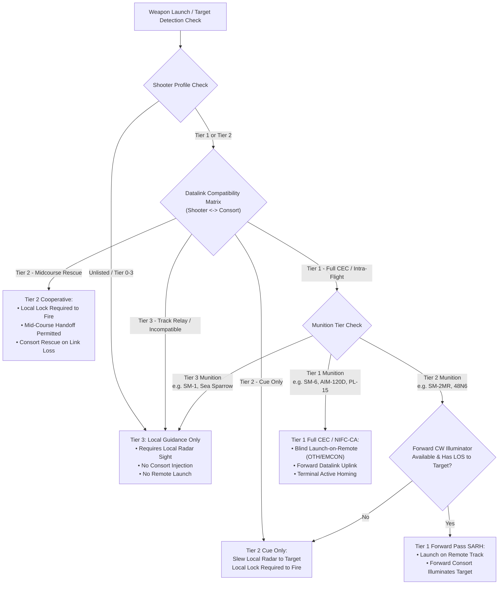

# Implementation Plan: Real-World Multi-Tier CEC & Datalink Restructure

This plan details the technical redesign and implementation to align **Sea Power CEC (`CecMod`)** with real-world naval and air warfare doctrine, based on the verified dataset from the Google Drive spreadsheet (344 ships, 132 aircraft, 287 radars, 182 munitions, and the 10x10 datalink compatibility matrix).

---

## 1. Goal Description

### The Problem
In `CecMod` v0.3.0, nearly every platform and weapon is treated as CEC-capable. The mod infers network membership (`UsAlliedNaval`, `RuNaval`, `PlanNaval`) whenever a platform possesses *any* sensor matching a broad dictionary or prefix fallback (e.g., `SPG-51`, `MK92`, `SPS-49`, `MK-95`, `Top Steer`, `Pop Group`). Because vanilla Sea Power sets `HasDataLink = True` on nearly all search radars, Cold War platforms (*Knox*, *Oliver Hazard Perry*, early *Adams*, *Spruance*, *Udaloy*, *Kirov*) and legacy munitions (`RIM-66A` SM-1, `RIM-7E` Sea Sparrow, `SA-N-4` 9M33) are granted full Over-The-Horizon (OTH) Launch-on-Remote, EMCON blind-firing, and mid-flight consort handoffs as if they were equipped with modern USN NIFC-CA or PLAN AESA battle networks.

### The Solution
Restructure the mod into a strict, layered qualification engine reflecting real-world military capabilities:
1. **4-Tier Capability Model**:
   - **Tier 1 (Full CEC / NIFC-CA / PLAN "A-Shoot-B-Guide")**: Blind Launch-on-Remote (OTH/EMCON), third-party mid-course & terminal handoff, composite track sharing.
   - **Tier 2 (Mid-Course Cooperative / Link 16 / HN-900 / Fort-TVM)**: **No Launch-on-Remote** (shooter requires local radar tracking to launch); supports mid-course handoff and consort track rescue.
   - **Tier 3 (Local Guidance Only / Link 11 / Track Relay)**: **No Launch-on-Remote, no mid-course handoffs**. Pure local guidance (missile guided exclusively by launching ship's own FCR). Datalink is track relay only.
   - **Tier 0 (Standalone)**: No datalink, IR / unguided munitions.
2. **10x10 Pairwise Datalink Compatibility Matrix**:
   - Capabilities between any two platforms are determined by their datalink standard intersection (`USG-2/3 CEC`, `TTNT`, `Link 16`, `Link 11`, `IFDL`, `MADL`, `JSIDLS`, `HN-900`, `RuNaval / Fort-TVM`, `TKS-2 / APD-518`).
3. **Munition Tier Gating**:
   - Tier 1 ARH missiles (`SM-6`, `AIM-120D`, `PL-15`, `Aster 30`, `Meteor`) support full blind Launch-on-Remote.
   - Tier 2 SARH+DL missiles (`SM-2MR`, `48N6`, `HQ-16`, `ESSM Blk 1`) support mid-course handoff, and can only be launched remotely if a forward consort with a compatible physical CW illuminator has line of sight to the target (Forward Pass).
   - Tier 3 legacy missiles (`SM-1MR`, `AIM-7`, `Sea Sparrow`, `SA-N-4`, `RIM-24`) are strictly locked to local launcher guidance.
4. **Compiled In-Memory Static Lookup Tables**:
   - High-performance, zero-allocation C# static lookup tables generated directly from the spreadsheet CSVs via a Python tool, fully updatable whenever new data is added.



---

## 2. User Review Required

> [!IMPORTANT]
> **Deliberate Tactical Handoff (EMCON Turn-Away)**:
> Per your guidance, for Tier 2 cooperative engagements, a ship with local lock that launches an SM-2 or R-77 can deliberately turn away and cut its radar (entering EMCON) to let a networked consort take over mid-course guidance. This is not restricted to emergency distress / sinking.

> [!IMPORTANT]
> **Intra-Flight Boundary for Stealth Aircraft (F-22 IFDL, F-35 MADL, MiG-31 APD-518)**:
> Evaluated strictly by `flight group`: aircraft sharing the same flight leader / spawned in the same tactical flight element. Cross-flight communication requires an active Gateway platform (e.g., E-2D Hawkeye for F-35 MADL, but F-22 remains completely isolated in stealth mode with no gateway bridging).

> [!WARNING]
> **Breaking Behavior for Cold War Units**:
> Cold War surface combatants (*Knox*, *Oliver Hazard Perry*, *Spruance*, *Adams*, *Kidd*, *Udaloy*, *Sovremenny*) and legacy SAMs (*RIM-66A/B*, *RIM-7E*, *SA-N-4*, *SA-N-1*) will **NO LONGER** be able to launch missiles beyond their local radar mast horizon or while in EMCON. They will behave as historical isolated fire-control units.

---

## 3. Real-World Doctrine Verification & Findings

### Point 2: Tier 1 Platform Firing Tier 2 Munitions (Forward-Pass SARH)
* **Real-World Fact**: In US Navy Project Mountain Top (1996) and operational Aegis CEC doctrine, an Aegis cruiser (*Bunker Hill*) fired an SM-2 (SARH) at an over-the-horizon sea-skimming drone using CEC. The cruiser never saw the target; a forward station provided continuous-wave illumination for the SM-2 seeker.
* **Does this break our rule?**:
  - **No**: It refines the matrix. A Tier 2 SARH missile (`SM-2MR`, `48N6`, `HQ-16`) cannot perform Launch-on-Remote *by itself*. When fired by a Tier 1 shooter, it can only be launched on a remote track **if and only if** a networked Tier 1 consort is in position with an available physical continuous-wave illuminator (`SPG-62`, `Front Dome`, `Type 346`) that currently has line-of-sight and radar horizon to the target.
  - If no forward illuminator is in range of the target, the shot is **blocked** (reverting strictly to the Tier 2 rule: local lock required).
  - In contrast, a Tier 1 ARH missile (`SM-6`, `AIM-120D`, `PL-15`) requires no illuminator dish anywhere in the world and can always be launched remotely as long as any Tier 1 sensor tracks the target.

### Point 5: "Cue Only" in Tactical Datalinks
* **Real-World Fact**: In tactical networking (Link 16, HN-900), "Cue Only" passes coordinate vectors to point/slew the receiving ship's radar. The receiver must detect and track the target locally with its own sensors before launching.
* **Mod Rule**: In a "Cue Only" link:
  1. The contact appears on the tactical map/plotting table, allowing the player or AI to point/slew their sensors.
  2. `CanSearchSensorsSeeTarget` and `CheckTargetIsDetectableByFCR` return `false` for remote coverage.
  3. The shooter **cannot** launch until its own onboard radar establishes line-of-sight and radar lock on the target.
  4. The remote node does **not** provide mid-course flight corrections or terminal guidance to the shooter's missile.

### Point 7: Channel Allocation at Launch vs. In-Flight Handoff
* **Real-World Fact**: Mechanically-steered illuminator dishes (`SPG-62`) are only required for the final 6–10 seconds of an SM-2's flight. However, tactical data links (Link 16) lack the sub-second synchronization required to slave an illuminator on Ship B at the exact instant of launch from Ship A.
* **Mod Rule**:
  - **Tier 1 (CEC)**: If local illuminators are saturated, an available Tier 1 consort's illuminator can be pre-assigned at launch via composite scheduling.
  - **Tier 2 (Link 16)**: The shooter **must have a free local channel at launch**. Consort radars are **not** injected into `_associatedSensors` at launch. However, once the missile is airborne, if the shooter turns into EMCON, gets jammed, or loses radar line-of-sight, `HandoffPatch` dynamically searches for a Tier 2 consort with free channels to execute an in-flight mid-course rescue!
  - **Tier 3 (Link 11 / Legacy)**: 100% self-contained local guidance from launch to impact. No launch-time consort injection, no in-flight handoffs.

### Point 8: AWACS Platform Guidance Scope
* **Real-World Fact**: AWACS aircraft (`E-2D`, `E-3 Sentry`, `A-50 Mainstay`, `KJ-500`) carry high-power surveillance/AEW radars, but **zero** terminal continuous-wave (CW) illuminators (e.g., they have no SPG-62 or 30N6E dishes).
* **Mod Rule**:
  - AWACS platforms are strictly qualified for **Tier 1 ARH missiles** (`SM-6`, `AIM-120D`, `PL-15`) where only track broadcast/mid-course updates are needed and the missile's onboard active seeker performs terminal homing.
  - AWACS platforms **cannot** provide terminal illumination for Tier 2 SARH missiles (`SM-2MR`, `48N6`, `HQ-16`). A surface combatant with physical illuminators is required for SARH terminal phase.

### Point 9: Satellite Uplink / GPS Weapon Guidance (`eu_GPS_Receiver` in Euromod)
* **Investigation Findings**:
  - In Euromod (`3629144864/systems/sensors.ini`), modern satellite guidance is implemented via a virtual sensor `[eu_GPS_Receiver]`:
    - `Kind = Radar`, `Type = Targeting`, `Mode = RadioCommand`
    - `TargetChannels = 5000`, `WeaponChannels = 5000`
    - `MaxRange = 45000.0` km (orbital scale), `MaxAltitude = 3000000` m (3,000 km low-Earth orbit).
  - This design bypasses 4/3-Earth radar horizon limits for GPS/satellite-guided cruise weapons (`Tomahawk Block IV/Va`, `MdCN`, `SCALP Naval`, `LRASM`).
* **User Decision**:
  - If a weapon is guided by SATCOM, let it be guided by SATCOM — it is superior to all terrestrial links and not bound by line-of-sight mast limits.
  - **Dynamic Sensor-Derived Range & Altitude Capping**: Instead of hardcoding arbitrary range caps (e.g. 60 nmi or 300 nmi constants in C#), dynamically inherit the datalink range and altitude directly from the platform's sensor properties (`_maxRange`, `_maxAltitude`, and mount/aircraft `transform.position.y`). This ensures:
    - Terrestrial radars/links naturally clamp to `min(radarHorizon, sensor._maxRange)`.
    - SATCOM transceivers (`eu_GPS_Receiver` with 45,000 km range and 3,000 km altitude) automatically have planetary reach without special-case hacks.
    - User/mod modifications to radar ranges in `.ini` files are immediately and dynamically respected by the datalink engine.

### Point 10: Real-World Anti-Ship Missile (ASuW) Datalinks
* **Real-World Fact & User Decision (Follow Real World)**:
  - **Cold War Generation (Harpoon Block 1, Exocet MM38/40 Blk 1, SS-N-2 Styx)**: 100% "Fire-and-Forget". Once launched, they had **no mid-course datalink**. Launching ships had to compute lead angles before firing; the missile flew inertially to an activation zone and turned on its seeker. If the target maneuvered out of the seeker basket, it missed.
    - *Mod Behavior*: **Tier 3 (Local Fire-and-Forget)**. No consort mid-course updates.
  - **OTH-T Radio Datalink (Otomat Mk 2 with TG-2/LEDA, P-700 Granit, P-800 Oniks)**: Designed specifically for over-the-horizon guidance. A forward platform (AB-212 helicopter, Tu-95RTs, or consort ship) transmitted radio command heading corrections to re-vector the missile in flight. Otomat even supported a 2-way link feeding seeker imagery back to ship operators.
    - *Mod Behavior*: **Tier 2 (Cooperative Mid-Course Update)**. Allows consort / helicopter radio command vectoring.
  - **Modern Tactical Networks & SATCOM (Maritime Strike Tomahawk Block Va, LRASM, NSM)**: Uses two-way SATCOM and tactical grids (Link 16 / TTNT) to loiter, receive dynamic re-targeting updates across hundreds of miles, and coordinate multi-axis strikes.
    - *Mod Behavior*: **Tier 1 / Satcom**. Global multi-domain network and satellite mid-course re-vectoring.

### Point 11: Dynamic Missile Kinematics, NEZ & Hover UI Architecture
* **How Vanilla Sea Power Calculates Ranges on Hover (`AttackingState.cs` & `ObjectBase.GetMaxEngagementRanges`)**:
  - The game evaluates three distinct boundaries when a weapon is selected and hovered over a target:
    1. **Kinematic Range (`KinematicRange`)**: Numerically simulated by `MissileSimulator.EstimateShot` and cached via `KinematicsCache`. Accurately integrates rocket thrust, atmospheric drag vs altitude, optimal loft altitude (`SearchOptimalLoftAltitude`), target altitude, target closing/receding velocity, and evasive maneuvers.
    2. **No-Escape Zone (`NoEscapeRangePrecise` / NEZ)**: Sub-envelope where an evasive target cannot turn or outrun the missile.
    3. **Sensor / FCR Range (`SensorRange` / `GetMaxRangeForFCR`)**: The physical radar/illuminator line-of-sight and mast horizon (`GetAmmunitionHorizons`).
    4. **Terrain Range (`TerrainRange`)**: Line-of-sight terrain blockage.
  - **Vanilla Clamping Formula**:
    $$\text{Launch Limit} = \min(\text{KinematicRange}, \;\text{SensorRange}, \;\text{TerrainRange})$$
    In vanilla, even if an SM-6 or SM-2 has the kinematic fuel to reach an incoming bomber at 120 nm, the launching ship's local 20–25 nm radar horizon (`SensorRange`) clamps the shot to 25 nm, preventing launch.
* **How CEC Approaches Missile Kinematics & NEZ**:
  - **Never Override Missile Kinematics**: The missile's native aerodynamic simulation (`KinematicRange`, NEZ, time of flight) remains the **hard physical ceiling**. CEC does **not** grant infinite fuel or arbitrary range.
  - **Tier 1 (Launch-on-Remote / CEC / NIFC-CA)**:
    - When a remote Tier 1 consort (e.g. E-2D Hawkeye) holds a radar track on the target, CEC extends `GetMaxRangeForFCR` and zeros `HorizonRangeRef`, removing the artificial 25 nm local mast horizon clamp.
    - The firing ring on the map dynamically expands to the **True Kinematic Range** against that specific target vector!
    - If the target is 90 nm away and incoming (Kinematic Reach = 110 nm) $\rightarrow$ **Launch Allowed / Ring Green**.
    - If the target is 90 nm away but fleeing supersonic at sea level (Kinematic Reach = 50 nm) $\rightarrow$ **Target Too Far / Ring Red**.
    - Hover tooltip displays: native `KinematicRange`, `NoEscapeRange`, and remote `SensorRange`.
  - **Tier 2 (Cooperative Mid-Course / Link 16 / HN-900 / Fort-TVM)**:
    - **Launch-on-Remote is blocked**. The firing ring at launch remains clamped to $\min(\text{KinematicRange}, \text{LocalRadarHorizon})$.
    - Hovering over an OTH target beyond local radar horizon shows `Issue_CantSeeTarget` (yellow warning) — the player clearly sees the missile *could* fly there kinematically, but cannot be launched without local radar lock.
    - Once airborne with local lock, if the shooter turns into EMCON, `HandoffPatch` allows the consort to guide the missile across its full kinematic flyout.
  - **Tier 3 (Local Guidance Only / Link 11 / Legacy)**:
    - 100% clamped to local radar horizon and local FCR channels. Firing ring never exceeds local radar sight.
  - **SATCOM / GPS Weapons (`Tomahawk Block IV/Va`, `LRASM`)**:
    - With `eu_GPS_Receiver` providing global sensor coverage, launch limits are purely governed by the weapon's aerodynamic fuel/waypoint envelope.

### Point 12: Real-World Consort Guidance & Network Limits
* **Per Individual Missile (Active Guidance Channels)**:
  - **At any single instant in time**: Exactly **ONE (1)** consort can actively guide / illuminate a specific missile. Datalink uplinks and continuous-wave illumination are pulse-coded, cryptographically keyed, and addressed point-to-point to the missile's unique transponder UID. Two simultaneous transmitters would cause co-channel RF interference and command jamming.
  - **Across the flight profile (Sequential Handoffs)**: Typically **1 Shooter + 1 Consort**. In deep OTH engagements (NIFC-CA kill chain), a missile can experience **at most 2 sequential handoffs** (e.g., Shooter launches $\rightarrow$ Forward F-35 provides initial mid-course vector $\rightarrow$ hands off to forward DDG for terminal phase). More than 2 handoffs in a 60–90s flyout is avoided due to crypto re-keying latencies.
* **Per Battle Network (Fleet / Task Group Capacity)**:
  - **AN/USG-2 CEC**: Hardware limit of the Data Distribution System (DDS) and Cooperative Engagement Processor (CEP) is **16 to 19 active nodes** per carrier strike group / battle group. Beyond ~19 nodes, raw uncompressed radar plot streams saturate DDS bandwidth.
  - **Link 16**: Uses TDMA time-slots. While hundreds of units share the theater air picture, weapon coordination groups operate in tactical elements of **4 aircraft** (flight) or **4 to 8 ships** (Surface Action Group).
  - **Russian APD-518**: Strictly a **4-aircraft flight element** (MiG-31).
  - **Russian Fort-TVM**: **2 to 4 escort combatants** in a naval group.
* **Mod Implementation Rule**:
  - Exactly 1 active guiding sensor in `Missile._guidingRadar` at any moment.
  - Consort physical channel limits (e.g., 3 `SPG-62` dishes on an Arleigh Burke = max 3 simultaneous terminal illuminations) are strictly enforced.
  - Task force sizes in *Sea Power* (2–10 ships) naturally fit well within real-world 19-node CEC limits.

---

## 4. UI Telemetry Feedback Examples (Point 10)

The missile control panel (`ObjectMissileControlViewModel.ObjectState`) will clearly display the active Guider, Connection Tier, and Datalink Protocol:

```
┌─────────────────────────────────────────────────────────────┐
│ MISSILE TELEMETRY EXAMPLES                                  │
├─────────────────────────────────────────────────────────────┤
│ 1. Tier 1 Full CEC / NIFC-CA (Shooter firing on remote E-2D track):│
│    Data Link: E-2D Hawkeye [NIFC-CA / USG-3 | Tier 1]       │
│                                                             │
│ 2. Tier 1 Consort Illuminator Forward Pass (SM-2 terminal): │
│    Data Link: DDG-80 Roosevelt [USG-2 CEC | Tier 1 SARH]    │
│                                                             │
│ 3. Tier 2 Cooperative (Local Launch, Ship maintaining link):│
│    Data Link: CG-47 Ticonderoga [Link 16 | Tier 2]          │
│                                                             │
│ 4. Tier 2 Mid-Course Handoff (Shooter turned into EMCON):   │
│    Data Link: DDG-51 Arleigh Burke [Link 16 Rescue | Tier 2]│
│                                                             │
│ 5. Tier 3 Local FCR Only (Knox / Perry / Udaloy):           │
│    Data Link: FF-1052 Knox [Local FCR | Tier 3]             │
│                                                             │
│ 6. ExtendedGuidance 0.25s Telemetry Row:                    │
│    DL: OK (24 nm) [USG-2 CEC | Tier 1] | Intercept: 18s     │
│    Guider: DDG-80 Roosevelt                                 │
│    Target: Tu-22M3 Backfire                                 │
└─────────────────────────────────────────────────────────────┘
```

---

## 5. Proposed Changes

Grouped by component, in logical execution order.

### Component A: Data Generation & Static Tables

#### [NEW] `tools/generate_cec_tables.py`
A standalone Python script that reads the 4 entity CSVs and `02_Datalink_Compatibility_Matrix.csv` from `data/cec_tables/` and outputs `CecMod/CecDataTables.g.cs`.

```python
# Parses 03_Ships.csv, 04_Aircraft.csv, 05_Radars.csv, 06_Missiles.csv, 02_Datalink_Compatibility_Matrix.csv
# Generates strongly-typed static readonly Dictionary<string, PlatformProfile>,
# Dictionary<string, RadarProfile>, Dictionary<string, MissileProfile>, and InteractionTier[,] matrix.
```

#### [NEW] `CecMod/CecDataTables.g.cs`
Generated C# partial class file providing $O(1)$ immutable lookup tables:
- `PlatformProfile`: `CecTier`, `DatalinkStandard` flags, `CecNetwork`, `SarhIllumFamily`.
- `RadarProfile`: `CecTier`, `DatalinkType`, `SarhIllumFamily`.
- `MissileProfile`: `CecTier`, `GuidanceFamily`, `DatalinkType`, `AllowLaunchOnRemote`, `AllowMidCourseHandoff`.
- `DatalinkMatrix`: Evaluates `(SenderDatalink, ReceiverDatalink) -> InteractionTier`.

---

### Component B: Core Qualification Engine

#### [MODIFY] `CecMod/CecCapability.cs`
- Define enums:
  - `CecTier { Tier0 = 0, Tier3 = 3, Tier2 = 2, Tier1 = 1 }`
  - `DatalinkStandard { None = 0, Usg2Cec = 1, Ttnt = 2, Link16 = 3, Link11 = 4, Ifdl = 5, Madl = 6, Jsidls = 7, Hn900 = 8, RuFortTvm = 9, Tks2Apd518 = 10, RuNavalTactical = 11, SatcomUplink = 12 }`
  - `InteractionTier { Incompatible = 0, Tier3_TrackRelay = 1, Tier2_CueOnly = 2, Tier2_MidcourseRescue = 3, Tier1_FullCec = 4, Tier1_IntraFlightOnly = 5, GatewayRequired = 6, SatcomGlobal = 7 }`
- **Dynamic Sensor-Derived Range & Altitude Capping**:
  - Deprecate hardcoded range caps (`SurfaceNetRangeCapUnits = 60nm`, `AirborneNetRangeCapUnits = 300nm`).
  - Datalink reach is dynamically determined by the platform's sensor properties:
    - Mount altitude / aircraft altitude (`r._mountObject.transform.position.y`).
    - Instrumented radar/datalink range (`r._radar._rp._maxRange`).
    - Maximum sensor altitude (`r._radar._rp._maxAltitude`).
    - Effective range between two nodes = `Mathf.Min(RadarCalculator.getRadarHorizon(h1, h2), sensor._maxRange)`.
    - For `SatcomUplink` (`eu_GPS_Receiver`): with `_maxRange = 45,000 km` and `_maxAltitude = 3,000 km`, it naturally encompasses the entire globe without needing hardcoded exceptions.
- Replace heuristic network guessing with exact dictionary lookups:
  - `GetPlatformProfile(ObjectBase platform)`: returns profile from `CecDataTables.Platforms` by `platform._obp._objectIniName`. Defaults to **Tier 3 (Local FCR only, Link 11)** if unlisted.
  - `GetMissileProfile(AmmunitionParameters ap)`: returns profile from `CecDataTables.Missiles` by `ap._ammunitionFileName`. Defaults to **Tier 3** if unlisted.
  - `GetRadarProfile(SensorSystemRadar r)`: returns profile from `CecDataTables.Radars` by normalized `_systemName`. Defaults to **Tier 3** if unlisted.
- Implement pairwise datalink evaluation:
  - `EvaluateInteraction(ObjectBase shooter, ObjectBase consort)`:
    - Queries matrix based on shooter's and consort's `DatalinkStandard`.
    - Handles `Tier1_IntraFlightOnly`: verifies `IsSameFlightGroup(shooter, consort)`.
    - Handles `GatewayRequired`: checks if task force contains an active gateway platform (e.g. `fr_e2d`, `usn_e-2d`, `usaf_e-7a`, `usn_fa-18f_blk3`). F-22 is excluded from gateways (stealth intra-flight only).
- Implement `CanPerformLaunchOnRemote(ObjectBase shooter, AmmunitionParameters ap, ObjectBase target)`:
  - Enforces:
    1. Shooter platform must be Tier 1 (or equipped with Satcom for GPS/SATCOM weapons).
    2. Cooperator tracking the target must be Tier 1 (or target track provided by Satcom/satellite network).
    3. Interaction between shooter and cooperator must be `Tier1_FullCec`, `SatcomGlobal`, or valid `Tier1_IntraFlightOnly`.
    4. Missile must be Tier 1 ARH/Satcom, **OR** Tier 2 SARH with an available consort physical illuminator having LOS to the target.
- Implement `CanPerformMidCourseHandoff(Missile m, SensorSystemRadar candidateRadar)`:
  - Missile must be Tier 1 or Tier 2 (Tier 3 legacy ASuW/SAMs like Harpoon Blk 1 / SM-1 strictly blocked).
  - Candidate consort interaction must be `Tier1_FullCec`, `Tier2_MidcourseRescue`, or `SatcomGlobal`.
  - Candidate radar must meet guidance requirements (SARH family match for SARH, free channels).

---

### Component C: Harmony Patches

#### [MODIFY] `CecMod/Patches/RemoteEngagementPatch.cs`
- Hook `WeaponSystem.CanSearchSensorsSeeTarget`:
  - If shooter cannot see target locally, only return `true` if `CecCapability.CanPerformLaunchOnRemote(shooter, ap, target)` is true.
- Hook `WeaponSystem.CheckTargetIsDetectableByFCR` & `WeaponSystem.FCRDetectionRange`:
  - Only return remote FCR coverage if `CanPerformLaunchOnRemote` passes.
- Hook `WeaponSystem.CheckLocalRadarsSight`:
  - Prevent EMCON blind firing unless `CanPerformLaunchOnRemote` passes.

#### [MODIFY] `CecMod/Patches/LaunchTimeCecPatch.cs`
- In `RefreshConsortRadars`:
  - If the missile being fired is Tier 3: **abort immediately**; do not inject any consort sensors into `_vwp._associatedSensors`.
  - If the shooter is Tier 3: **abort immediately**.
  - If interaction with consort is `Tier2_CueOnly` or `Tier3_TrackRelay`: do not inject consort radars.

#### [MODIFY] `CecMod/Patches/HandoffPatch.cs`
- In `FindHandoffRadar`:
  - Check `GetMissileProfile(missile._ap).AllowMidCourseHandoff`. If false (Tier 3), return `null`.
  - Check `EvaluateInteraction(launcher, cooperator)`. If `Tier3_TrackRelay`, `Tier2_CueOnly`, or `Incompatible`, skip that cooperator.
  - Support intentional turn-away handoff: if shooter's radar enters EMCON (`IsPlatformInAirRadarEmcon`), immediately trigger consort handoff search.

#### [MODIFY] `CecMod/Patches/DatalinkUiPatch.cs`
- Format the datalink telemetry string:
  - Retrieve active guider name and interaction tier.
  - Format as: `guiderName + " [" + protocolName + " | " + tierName + "]"`.
  - Escape XML entities (`&amp;`, `&lt;`, `&gt;`) for UniRx / WPF UI rendering.

#### [MODIFY] `CecMod/EgBridge.cs`
- Update `PlanningLaunchVisibility` and `ReadNativeContact` bridges so `ExtendedGuidance` respect the Tier 1 / Tier 2 gating.

---

## 6. Verification Plan

### Automated Tests
1. **Lookup Table Integrity Test**:
   - Run Python verification script `scratch/verify_generated_tables.py` to ensure all 344 ships, 132 aircraft, 287 radars, and 182 missiles are parsed with zero nulls and match disk `.ini` IDs.
2. **Compilation**:
   - Execute `dotnet build CecMod\CecMod.csproj -c Release` with `-p:GameDir="G:\Program Files (x86)\Steam\steamapps\common\Sea Power"`. Verify build succeeds with zero errors.

### Manual In-Game Scenarios

#### Tier 2 Complete Test Case Matrix
The table below specifies all interactions involving Tier 2 platforms, munitions, and mixed networks:

| Test Case | Shooter Platform | Consort Platform | Munition | Target Situation | Expected Behavior |
| :--- | :--- | :--- | :--- | :--- | :--- |
| **T2-1: Pure Tier 2 Normal Launch** | CG-47 (Link 16) | DDG-51 (Link 16) | SM-2MR (Tier 2 SARH) | In local radar LOS (30 nm) | **Normal Launch**: Local lock acquired; local SPG-62 illuminates; consort remains idle. |
| **T2-2: Pure Tier 2 Blind OTH Attempt** | CG-47 (Link 16) | DDG-51 (Link 16) | SM-2MR (Tier 2 SARH) | Over shooter horizon (60 nm, tracked by DDG-51) | **BLOCKED**: Contact appears on map as Cue Only, but launch is blocked (`TargetIsNotDetectableByFCR`). No blind firing. |
| **T2-3: Tier 2 EMCON Turn-Away Handoff** | CG-47 (Link 16) | DDG-51 (Link 16) | SM-2MR (Tier 2 SARH) | Locked at 32 nm; shooter turns off radar mid-flight | **RESCUE SUCCESS**: `HandoffPatch` triggers, hands off to DDG-51; UI shows `DDG-51 [Link 16 Rescue \| Tier 2]`; consort illuminates; intercept succeeds. |
| **T2-4: Tier 2 Consort Saturated / EMCON** | CG-47 (Link 16) | DDG-51 in EMCON | SM-2MR (Tier 2 SARH) | Shooter turns off radar mid-flight | **RESCUE FAILS**: Consort has no active illuminator; handoff fails; missile goes ballistic and misses. |
| **T2-5: Forward Pass (Project Mountain Top)** | DDG-80 (Tier 1 USG-2 CEC) | CG-70 (Tier 1 USG-2 CEC with SPG-62) | SM-2MR (Tier 2 SARH) | Over DDG-80 horizon (45 nm), but in CG-70 illuminator LOS | **LAUNCH ALLOWED**: Forward consort has compatible CW illuminator with LOS; DDG-80 launches blind; CG-70 illuminates terminal phase. |
| **T2-6: Forward Pass Blocked (AWACS Consort)** | DDG-80 (Tier 1 USG-2 CEC) | E-2D Hawkeye (Tier 1 USG-2 CEC, no CW dish) | SM-2MR (Tier 2 SARH) | Over DDG-80 horizon (75 nm), tracked solely by E-2D | **BLOCKED**: E-2D lacks physical CW illuminator; SARH missile cannot home terminally; shot blocked (reverts to local lock required). |
| **T2-7: Mixed Tier 1 & Tier 2 Platforms** | CG-47 (Link 16 only) | DDG-80 (Tier 1 USG-2 CEC) | SM-2MR or SM-6 | Track passed from DDG-80 over Link 16 | **CUE ONLY**: CG-47 receives track coordinates to slew local radar, but cannot fire until local radar lock is established. |
| **T2-8: Tier 2 Munition on Legacy Platform** | FF-1052 Knox (Tier 3 Link 11) | Any consort | RIM-7E / SM-1MR (Tier 3) | Target at any range | **STRICTLY LOCAL**: No datalink injection, no handoffs, no consort rescue. |

---

### Step-by-Step Mathematical Breakdown: Tier 1 Range Calculation

When selecting a weapon and hovering over a target in Tier 1 CEC, the range is calculated through the following exact sequence:

1. **Missile Kinematic Reach ($R_{\text{kinematic}}$)**:
   - Evaluated by `MissileSimulator.EstimateShot`:
     $$\text{Accel} = \frac{T(t) - D(v, \rho(y))}{m(t)}$$
   - Factors in:
     - Target closing/receding vector: $R_{\text{closing}} \approx R_{\text{static}} + V_{\text{target}} \cdot t_{\text{flight}}$.
     - Optimal loft trajectory: `SearchOptimalLoftAltitudeCore` solves for optimal cruise altitude in thin air.
     - Target evasive capability: Computes $R_{\text{NEZ}}$ (`NoEscapeRangePrecise`).
2. **Battle-Network Line-of-Sight Chain**:
   - Platform link: $\text{Dist}(\text{Shooter}, \text{Consort}) \le \min\big(R_{\text{datalink\_max}}, \text{RadarHorizon}(H_{\text{shooter}}, H_{\text{consort}})\big)$
   - Target tracking: $\text{Dist}(\text{Consort}, \text{Target}) \le \min\big(R_{\text{radar\_max}}, \text{RadarHorizon}(H_{\text{consort}}, H_{\text{target}})\big)$
   - If Tier 2 SARH Forward Pass: $\text{Dist}(\text{Consort}, \text{Target}) \le \min\big(R_{\text{illuminator\_max}}, \text{RadarHorizon}(H_{\text{consort}}, H_{\text{target}})\big)$
3. **Lifting the Local Horizon Clamping**:
   - In vanilla: $\text{LaunchRange} = \min(R_{\text{kinematic}}, \;R_{\text{local\_mast\_horizon}}, \;R_{\text{terrain}})$.
   - In Tier 1 CEC: `HorizonRangeRef = 0` and `GetMaxRangeForFCR` returns remote coverage distance.
   - Local mast horizon is removed:
     $$\mathbf{R_{\text{effective}} = \min(R_{\text{kinematic}}, \;R_{\text{terrain}})}$$
   - The firing ring on the map expands dynamically to the **true kinematic reach** against that specific target vector.
