# Technical Assessment & Implementation Plan: Real-World Multi-Tier CEC Restructure

This document provides an exhaustive technical assessment of the proposed restructure in [`cec_real_world_restructure_plan.md`](file:///G:/Project/CEC_mod/cec_real_world_restructure_plan.md) and lays out the step-by-step engineering plan to implement it safely, performantly, and reliably within the *Sea Power* engine.

---

## 1. Technical Assessment of `cec_real_world_restructure_plan.md`

### 1.1 Advantages (Pros)

1. **Doctrinal Authenticity & Historical Balance**:
   - **Eliminates the "Cold War Super-Network" Bug**: In `CecMod` v0.3.0, any vessel with `HasDataLink=True` on any radar was treated as CEC-capable. Legacy 1960s–1980s combatants (*Knox*, *Oliver Hazard Perry*, *Spruance*, early *Adams*, *Kirov*, *Udaloy*, *Sovremenny*) and early SAMs (`RIM-66A` SM-1MR, `RIM-7E` Sea Sparrow, `SA-N-4` 9M33) could conduct Over-The-Horizon (OTH) blind launches on third-party tracks and mid-flight handoffs. The 4-Tier model strictly restricts Cold War units to their authentic local mast radar horizon and local FCR channels.
   - **Differentiates Real-World Battle Networks from Tactical Datalinks**: Separates true composite fire-control tracking (Tier 1: USG-2/3 CEC, NIFC-CA, APAR, JSIDLS) from tactical coordinate relay (Tier 2: Link 16, HN-900, Fort-TVM) and basic track broadcast (Tier 3: Link 11).

2. **Resolves the SARH Terminal Illumination Paradox (Point 2 & Point 8)**:
   - **SARH Physics Enforced**: Semi-Active Radar Homing missiles (`SM-2MR`, `48N6`, `HQ-16`, `ESSM Blk 1`) require a high-power Continuous Wave (CW) or ICWI dish illuminator (`SPG-62`, `Front Dome`, `Type 346`) reflecting RF off the target skin during terminal approach.
   - **AWACS Separation**: AWACS platforms (`E-2D`, `E-3`, `KJ-500`, `A-50`) carry massive surveillance/datalink arrays, but **zero CW illuminators**. Under this plan:
     - Active Radar Homing (ARH) missiles (`SM-6`, `AIM-120D`, `PL-15`, `Aster 30`) can be cued, launched OTH, and guided by AWACS all the way to terminal seeker handover.
     - SARH missiles fired by Tier 1 ships can *only* be launched remotely if a forward surface consort with a physical CW illuminator has line of sight to the target (the authentic US Navy 1996 **Project Mountain Top** doctrine).

3. **High-Fidelity Stealth & Flight-Level Isolation (Point 5 & Point 6)**:
   - Modern 5th-generation stealth fighters utilize directional, low-probability-of-intercept datalinks (F-22 Intra-Flight Data Link / IFDL; F-35 Multifunction Advanced Data Link / MADL; MiG-31 APD-518).
   - The pairwise matrix accurately restricts data sharing to intra-flight members unless an active airborne gateway platform (e.g., E-2D Hawkeye for F-35 MADL) is on station.

4. **Zero-Allocation $O(1)$ Performance**:
   - Compiling the verified Google Drive spreadsheet datasets (344 ships, 132 aircraft, 287 radars, 182 missiles, 10x10 matrix) into strongly-typed C# static tables (`CecDataTables.g.cs`) eliminates runtime string parsing, regex, and heap allocations during physics and render loops.

5. **Physical Sensor-Derived Range Capping (Point 9 & Point 10)**:
   - Replacing hardcoded range limits (`SurfaceNetRangeCapUnits = 60nm`, `AirborneNetRangeCapUnits = 300nm`) with dynamic formulas based on mount/aircraft altitude, 4/3-Earth radar horizon, and sensor `_maxRange` naturally accounts for all platform types.
   - Transparently handles SATCOM weapons (such as Euromod's `eu_GPS_Receiver` with 45,000 km range) across planetary scale without special-case hacks.

6. **Strict Preservation of Missile Aerodynamics & Kinematics (Point 11)**:
   - CEC strictly unclamps artificial sensor horizon limits (`GetMaxRangeForFCR` and `HorizonRangeRef`), but **never** tampers with `MissileSimulator.EstimateShot` or aerodynamic drag/thrust equations. The missile's true physical fuel envelope and No-Escape Zone (NEZ) remain immutable.

---

### 1.2 Disadvantages (Cons)

1. **Breaking Behavior for Cold War Campaigns & Scenarios**:
   - The majority of *Sea Power* base scenarios are set in the 1980s Cold War. In these scenarios, almost all platforms are Tier 2 or Tier 3.
   - Players accustomed to v0.3.0's generous taskforce-wide CEC will find their 1980s ships unable to blind-fire over the horizon. An SM-2 fired from a *Ticonderoga* without a forward CEC-equipped consort will strictly demand local radar tracking before launch.

2. **Player UX Friction with "Cue Only"**:
   - In tactical datalinks (Link 16, HN-900), "Cue Only" shares the target contact on the map/plotting table, but does not allow weapons release until local sensors detect and lock the target.
   - If the target is physically over the radar horizon, clicking the attack order will show "Target is not detectable by FCR" or "Cannot see target". Players unfamiliar with real-world datalink doctrine may perceive this as a broken fire button.

3. **Static Table Rigidity for Unindexed Mods**:
   - If a player installs a new Workshop mod or custom ship that is not present in the 344 ships CSV, it defaults to **Tier 3 (Local FCR only, Link 11)**.
   - A modern 2024 destroyer from an unindexed mod would be treated like a 1965 *Knox* frigate unless the CSV tables are regenerated and the mod recompiled.

4. **Maintenance Overhead**:
   - Updating or balancing unit tiers requires modifying the source CSVs, re-running the Python generator, and rebuilding the C# project.

---

### 1.3 Difficulties (Engineering & Technical Challenges)

```mermaid
flowchart TD
    subgraph Challenge1 ["1. Multi-Standard Datalink Resolution"]
        RawStr["Platform DataLinkType:<br/>'USG-2 CEC / Link 16'<br/>'MADL / Link 16'"] --> Bitmask["Parse into Bitmask Flags:<br/>DatalinkStandard.Usg2Cec |<br/>DatalinkStandard.Link16"]
        Bitmask --> CrossEval["Evaluate All Standard Pairs<br/>(Shooter Standards x Consort Standards)"]
        CrossEval --> MaxResolution["Select HIGHEST InteractionTier:<br/>Tier 1 Full CEC > Tier 2 Midcourse Rescue > Tier 2 Cue Only"]
    end

    subgraph Challenge2 ["2. Flight / Formation Tracking"]
        Unit["Aircraft Object"] --> FormationCheck{"unit.Formation != null?"}
        FormationCheck -->|Yes| FormationId["Extract Formation.LeaderStation.UnitObject"]
        FormationCheck -->|No| Detached["Fallback: ConditionalWeakTable cache<br/>stored on spawn/first seen"]
    end

    subgraph Challenge3 ["3. Forward Pass SARH Channel Saturation"]
        LaunchTime["Tier 1 Launch of Tier 2 SARH"] --> StandaloneCheck{"ExtendedGuidance Active?"}
        StandaloneCheck -->|Yes| EgTimeShare["Mid-course via DatalinkCarrier;<br/>Reserve CW dish only in terminal phase"]
        StandaloneCheck -->|No| VanillaConsume["Vanilla consumes consort SPG-62<br/>channel for ENTIRE flight"]
    end
```



#### Detailed Breakdown of Difficulties:

1. **Multi-Standard Datalink Parsing & Best-Protocol Resolution**:
   - **The Problem**: Real-world platforms frequently support multiple datalink standards. In `03_Ships.csv` and `04_Aircraft.csv`, entries contain composite strings such as `"USG-2 CEC / Link 16"`, `"Link 16 (MIDS) / Meteor Datalink"`, `"JSIDLS (HN-900) / AESA Link"`, `"MADL / Link 16"`, and `"TKS-2 / Spektr"`.
   - **The Challenge**: If Ship A has `USG-2 CEC` and `Link 16`, while Ship B only has `Link 16`:
     - Evaluating `USG-2 CEC` vs `Link 16` gives `Tier 2 - Cue Only`.
     - Evaluating `Link 16` vs `Link 16` gives `Tier 2 - Midcourse Rescue`.
   - **Solution**: The Python code generator maps composite string tokens into a strongly typed `[Flags] DatalinkStandard` enum bitmask. At runtime, `EvaluateInteraction(shooter, consort)` evaluates all standard combinations between shooter and consort and selects the **highest capability tier**.

2. **Aircraft Formation / Flight Tracking for Stealth Aircraft**:
   - **The Problem**: Stealth aircraft using IFDL (F-22) or MADL (F-35) must only share targeting data intra-flight unless a gateway (E-2D) is present.
   - **Engine Reality**: In *Sea Power*, an aircraft's formation is represented by `aircraft.Formation` (`SeaPower.UnitFormation`), with `aircraft.ActiveFormationLeader` pointing to the leader. However, when an aircraft takes evasive action, engages in dogfights, or is given independent orders, the game calls `MakeUnitActIndependently`, setting `aircraft.Formation = null`!
   - **Solution**: We cannot rely solely on live `aircraft.Formation`. We must cache each aircraft's initial formation leader / flight group in a `ConditionalWeakTable<Aircraft, ObjectBase>` when first detected airborne, ensuring detached wingmen do not lose their stealth datalink.

3. **Pre-Launch Forward Pass SARH Channel Saturation (Standalone vs `ExtendedGuidance`)**:
   - **The Problem**: When a Tier 1 shooter launches a Tier 2 SARH missile (`SM-2MR`) at an OTH target using a forward consort's illuminator (`SPG-62`):
     - Under `ExtendedGuidance`, the engine uses `DatalinkCarrier` for mid-course updates and reserves the physical CW dish only 6–10 seconds before impact.
     - In **standalone Sea Power** (without `ExtendedGuidance`), vanilla `WeaponBase.activateGuidingSystem` binds the consort's `SPG-62` immediately at launch, locking that radar channel for the missile's entire 60–90 second flight.
   - **Solution**: Adopted **Option A** (see Section 3). In standalone mode, consort channel consumption is enforced at launch (preventing over-allocation); under `ExtendedGuidance`, delayed terminal reservation is leveraged.

4. **Intentional EMCON Turn-Away Handoff Race Conditions**:
   - **The Problem**: A player launches an SM-2 with local radar lock, then immediately turns their ship around and shuts down their radar (EMCON) to let a networked consort take over.
   - In vanilla, when a guiding radar turns off (`IsOn == false`), `Missile.CheckRadioConnection` flags `ConnectionLost = true`, which becomes `ConnectionLostForever = true` if unguided for too long.
   - **Solution**: In `HandoffPatch`, we inspect whether the guider entered EMCON (`!currentRadar.IsOn.Value` or `IsPlatformInAirRadarEmcon`) on the **very first frame** of `OnUpdateEveryFrame` and execute `FindHandoffRadar` immediately, before `ConnectionLostForever` can trip.

5. **Entity ID Normalization Across Mods**:
   - Entities in mods like *Pacific 2027* append suffixes like `" (P2027)"`, while other mods use prefixes (`"eu_"`, `"plaaf_"`, `"rfn_"`).
   - The table generator and lookup routines maintain normalized canonical keys (stripping suffixes and normalizing delimiters) while retaining the original raw strings for engine bindings.

---

### 1.4 Limitations (Hard Engine & Environment Constraints)

1. **Sea Power AI Cannot Autonomously Plan Complex Multi-Ship Tactics**:
   - While we can enforce strict gating on the AI (preventing the AI from launching when it lacks valid datalink coverage), the AI's tactical state machine cannot proactively execute intentional turn-away EMCON maneuvers ("Ship A shoots, Ship A turns off radar and retreats while ordering Ship B to illuminate").
   - Intentional turn-away EMCON handoffs are primarily a **player-controlled tactic**. The AI will only benefit from handoffs when forced by circumstances (e.g., launcher sunk, radar damaged, or terrain-masked).

2. **Abstracted RF Physics**:
   - *Sea Power* abstracts radar emissions into frequency bands (X, S, C, L, UHF) and generic seeker types. The mod enforces logical channel limits and SARH illuminator family compatibility, but cannot simulate microsecond continuous-wave Doppler clutter, co-channel RF jamming, or multi-path interference.

3. **Dynamic Kinematic Range Snapshots vs High-G Maneuvering Targets**:
   - In `AttackingState`, the range ring displayed on hover is evaluated by `MissileSimulator.EstimateShot` against the target's current velocity vector.
   - If a target is flying at Mach 2.5 directly toward the shooter, the missile's kinematic reach expands dramatically (e.g. 100 nm). If the target executes a 180° turn and flees at sea level, the true kinematic reach shrinks to 40 nm. This dynamic behavior is an inherent property of the game's simulation engine.

4. **Closed-Source Mod Distribution**:
   - Any third-party mod that creates entirely bespoke missile classes that do not inherit from `SeaPower.Missile` would bypass our Harmony hooks. (In practice, 100% of public Sea Power mods subclass the standard engine types).

---

### 1.5 Performance & CPU Profile Analysis

Is `CecMod` CPU-intensive? **No.** Despite complex multi-ship networking rules, the mod runs with near-zero CPU overhead due to four architectural safeguards:

1. **Event-Driven & Throttled Execution**:
   - Healthy in-flight missiles execute a single 1-cycle guard clause (`if (!linkBroken && !needsTerminalPromotion) return;`) and exit immediately.
   - When a radar is destroyed, `HandoffPatch` applies a **1.0-second cooldown** (`RetryCooldownSeconds = 1.0`), preventing high-frequency frame polling.
   - Launch-time consort scans (`RefreshConsortRadars`) are throttled to **5.0-second intervals**.
2. **Massive 4-Tier Early Exit**:
   - Cold War platforms and legacy munitions (Tier 3/Tier 0) bypass all matrix and network calculations with an immediate integer check (`if (tier == CecTier.Tier3) return;`).
3. **Zero Heap Allocations ($O(1)$ Tables)**:
   - All lookups use static pre-hashed dictionaries and bitwise operators. Zero garbage collection (GC) allocations occur in hot flight loops.
4. **Lightweight Math**:
   - Distance checks use squared Euclidean distances (`dx*dx + dz*dz`) and 4/3-Earth horizon square roots (~10 cycles). In a 10-ship fleet, `FindHandoffRadar` executes in **< 0.05 milliseconds**, several orders of magnitude faster than vanilla *Sea Power*'s own aerodynamic numerical integrator (`MissileSimulator.EstimateShot`).

---

### 1.6 Altitude vs. Ground Distance Mathematics

Altitude is the **primary physical driver** of radar and datalink reach in the mod:

```
                  E-2D Hawkeye (30,000 ft)
                       ▲
                       │ Altitude (H_radar)
                       ▼
───────────────────────O────────────────────────────  (Earth Tangent Line)
        \              │                           /
         \             │                          /   Direct Line of Sight
          \            │                         /
           \           │                        /
            \          │                       /
             \         ▼                      ▼
  (Sea Level) ~~~~~~~~~~~~~~~~~~~~~~~~~~~~~~~~~~~~~~~~~ Incoming Target
              |<─────── Horizontal Ground Distance ───>| (15 meters altitude)
              |              (2D Pythagorean)          |
```

1. **Vertical Dimension ($Y$) $\rightarrow$ Earth Curvature Radar Horizon**:
   Altitude feeds directly into `RadarCalculator.getRadarHorizon(H_radar, H_target)`:
   $$D_{\text{horizon}} = \sqrt{2 \cdot R_{\text{Earth}} \cdot H_{\text{radar}}} + \sqrt{2 \cdot R_{\text{Earth}} \cdot H_{\text{target}}}$$
   - A surface ship with a 25-meter mast looking at a 15-meter sea-skimmer has a horizon of **~20 nm**.
   - An E-2D Hawkeye at 30,000 ft (9,144 m) expands the horizon to **~225 nm** against that same sea-skimmer.
2. **Horizontal Plane ($X, Z$) $\rightarrow$ 2D Ground Distance**:
   $$D_{\text{ground}} = \sqrt{(X_1 - X_2)^2 + (Z_1 - Z_2)^2}$$
3. **The Line-of-Sight Evaluation**:
   - If $D_{\text{ground}} \le D_{\text{horizon}}$, the target is above the Earth's curvature $\rightarrow$ **Line of sight exists**.
   - If $D_{\text{ground}} > D_{\text{horizon}}$, the target is below the Earth's curvature $\rightarrow$ **Masked by horizon**.
   - For direct 3D straight-line slant range, the engine's native `SensorSystemRadar.GetRange` computes signal attenuation and radar cross section (RCS).

---

## 2. User Review Required

> [!IMPORTANT]
> **Deliberate Tactical Handoff (EMCON Turn-Away)**:
> In Tier 2 cooperative engagements, a ship with local lock that launches an SM-2 or R-77 can deliberately turn away and cut its radar (entering EMCON) to let a networked consort take over mid-course guidance. This behavior is enabled for both players and AI.

> [!IMPORTANT]
> **Intra-Flight Boundary for Stealth Aircraft (F-22 IFDL, F-35 MADL, MiG-31 APD-518)**:
> Evaluated by initial flight formation leader. Cross-flight communication requires an active Gateway platform (e.g., E-2D Hawkeye for F-35 MADL). The F-22 remains completely isolated in stealth mode without gateway bridging.

> [!WARNING]
> **Breaking Behavior for Cold War Units**:
> Cold War surface combatants (*Knox*, *Oliver Hazard Perry*, *Spruance*, *Adams*, *Kidd*, *Udaloy*, *Sovremenny*) and legacy SAMs (*RIM-66A/B*, *RIM-7E*, *SA-N-4*, *SA-N-1*) will **NO LONGER** be able to launch missiles beyond their local radar mast horizon or while in EMCON.

---

## 3. Finalized User Decisions

> [!NOTE]
> **Decision 1: Strict Tier 3 Default for Unindexed Units (Approved)**:
> - Any ship, aircraft, radar, or weapon not present in the verified CSV dataset defaults strictly to **Tier 3 (Local FCR only / Link 11)**.
> - No heuristic guessing or external config files. Guarantees 100% deterministic behavior and zero unexpected side effects.

> [!NOTE]
> **Decision 2: Contextual Attack Hover Telemetry & Attack Order Preservation (Approved)**:
> - **Attack Cursor Preservation**: In vanilla *Sea Power*, the attack cursor (`attackunit`) is never disabled simply due to range/horizon; it only disables when a weapon cannot engage a domain (e.g. torpedo vs plane). For Tier 2 "Cue Only" contacts, the attack cursor **remains fully enabled (`attackunit`)**. When the player clicks attack, the ship receives the attack task (`AddAttackTask`), maneuvers toward the target, and automatically fires the moment the target enters local radar sight.
> - **Attack-Hover-Only Telemetry (Zero Map Clutter)**: To keep the tactical map 100% clean during normal navigation, permanent contact tags (`ContactInfoLine1..4`) are not modified. Datalink telemetry is displayed strictly when hovering over a contact with a weapon selected (`ContactMouseoverInfo` in `MapUnitViewModel`):
>   - **Tier 2 Cue Only (Local lock needed to fire)**: `<Run Foreground="#FFF176">Cued via Link 16 (Local radar lock required to fire)</Run><LineBreak/>` (Yellow)
>   - **Tier 1 Blind OTH / EMCON (ARH, e.g. SM-6)**: `<Run Foreground="#4FC3F7">CEC Track: {ConsortName} [{Protocol} | Tier 1]</Run><LineBreak/>` (Cyan)
>   - **Tier 1 Forward Pass (SARH, e.g. SM-2MR)**: `<Run Foreground="#81C784">Forward Pass: {ConsortName} [{IlluminatorRadar}]</Run><LineBreak/>` (Green)
>   - **Normal Local Shot**: Clean (no CEC text appended).
> - Preserves native attack-order workflow while providing complete clarity during weapon aiming.

> [!NOTE]
> **Decision 3: Option A Approved (Respect Vanilla Channels in Standalone Mode)**:
> - In **standalone Sea Power** (without `ExtendedGuidance`), when a Tier 1 shooter launches an SM-2 on a forward consort's illuminator (Project Mountain Top forward pass), the consort's illuminator channel is reserved at launch for the full flight.
>   - Guarantees 100% stability, zero risk of guidance loss from mid-course handoff races, and full adherence to vanilla engine channel limits.
> - When **`ExtendedGuidance` is active**, `CecMod` automatically defers to `ExtendedGuidance`'s realistic time-shared terminal reservation (reserving the physical CW dish only 6–10s before impact).

> [!NOTE]
> **Decision 4: Autonomous Employment ("Engage Free" / "Weapons Free")**:
> - Autonomous AI targeting on "Engage Free" (`WeaponStatus.Free`) uses the exact same underlying methods (`WeaponSystemLauncher.OnUpdate`, `ObjectBase.DoesAmmoMatchTarget`, `ObjectBase.GetMaxRangeForFCR`, and `WeaponSystem.CheckTargetIsDetectableByFCR`).
> - **Tier 1 Platforms (SM-6 / NIFC-CA)**: The AI on "Engage Free" will detect remote consort tracks, pass pre-launch FCR gates, and automatically launch OTH without requiring manual player designation.
> - **Tier 2 Platforms (Link 16 / SM-2)**: The AI on "Engage Free" receives `false` from `CheckTargetIsDetectableByFCR` while the target is beyond local horizon, preventing premature missile expenditure. The ship closes distance and automatically fires the instant local radar lock is achieved.
> - **Tier 3 Platforms (Link 11)**: Purely local autonomous firing.
> - **Doctrine Note**: "Weapons Tight" remains the recommended fleet posture; "Engage Free" allows Tier 1 ships to autonomously execute maximum-range OTH salvos against detected bogeys.

---

## 4. Proposed Changes

Grouped by component, in logical execution order.

### Component A: Data Generation & Static Tables

#### [NEW] `tools/generate_cec_tables.py`
A Python generator script that parses all 5 CSVs from `data/cec_tables/` and generates strongly-typed, zero-allocation C# static classes:
- Parses `03_Ships.csv`, `04_Aircraft.csv`, `05_Radars.csv`, `06_Missiles.csv`, and `02_Datalink_Compatibility_Matrix.csv`.
- Maps composite datalink strings into `DatalinkStandard` bitmasks.
- Emits `CecMod/CecDataTables.g.cs` containing:
  - `Dictionary<string, PlatformProfile> Platforms`
  - `Dictionary<string, RadarProfile> Radars`
  - `Dictionary<string, MissileProfile> Missiles`
  - `InteractionTier[,] DatalinkMatrix`

#### [NEW] `CecMod/CecDataTables.g.cs`
Generated partial class containing compiled lookup dictionaries with $O(1)$ access and zero heap allocations during gameplay.

---

### Component B: Core Qualification Engine

#### [MODIFY] `CecMod/CecCapability.cs`
- Define new core enums:
  - `CecTier { Tier0 = 0, Tier3 = 3, Tier2 = 2, Tier1 = 1 }`
  - `[Flags] DatalinkStandard { None = 0, Usg2Cec = 1 << 0, Ttnt = 1 << 1, Link16 = 1 << 2, Link11 = 1 << 3, Ifdl = 1 << 4, Madl = 1 << 5, Jsidls = 1 << 6, Hn900 = 1 << 7, RuFortTvm = 1 << 8, Tks2Apd518 = 1 << 9, RuNavalTactical = 1 << 10, SatcomUplink = 1 << 11 }`
  - `InteractionTier { Incompatible = 0, Tier3_TrackRelay = 1, Tier2_CueOnly = 2, Tier2_MidcourseRescue = 3, Tier1_FullCec = 4, Tier1_IntraFlightOnly = 5, GatewayRequired = 6, SatcomGlobal = 7 }`
- **Multi-Standard Pairwise Evaluation**:
  - Implement `EvaluateInteraction(ObjectBase shooter, ObjectBase consort)` to iterate over all active datalink standards and resolve to the highest-ranking `InteractionTier`.
- **Dynamic Physics-Based Net Reach**:
  - Deprecate hardcoded 60nm/300nm range caps.
  - Compute datalink line-of-sight based on transmitter/receiver antenna elevations, 4/3-Earth radar horizon, and sensor `_maxRange`.
- **Flight Group Caching**:
  - Implement `ConditionalWeakTable<Aircraft, ObjectBase> _flightGroupLeaders` to reliably evaluate intra-flight stealth communications even when wingmen maneuver independently.
- **Strict Launch-on-Remote Gate**:
  - Implement `CanPerformLaunchOnRemote(ObjectBase shooter, AmmunitionParameters ap, ObjectBase target)`:
    - Enforces that both shooter and tracking consort are Tier 1 (or Satcom).
    - Checks munition tier: Tier 1 ARH missiles allow blind launch; Tier 2 SARH missiles require an active forward consort with a compatible CW illuminator possessing direct line of sight to the target.
- **Strict Mid-Course Handoff Gate**:
  - Implement `CanPerformMidCourseHandoff(Missile m, SensorSystemRadar candidateRadar)`:
    - Disallows handoffs for Tier 3 legacy munitions (e.g., Harpoon Blk 1, RIM-66A, RIM-7E).
    - Allows handoff for Tier 1 and Tier 2 munitions if the consort interaction is `Tier1_FullCec`, `Tier2_MidcourseRescue`, or `SatcomGlobal`.

---

### Component C: Harmony Patches

#### [MODIFY] `CecMod/Patches/RemoteEngagementPatch.cs`
- In `CanSearchSensorsSeeTarget_Postfix`, `IsVisionRequirementMet_Postfix`, `GetMaxRangeForFCR_Postfix`, and `GetSensorRange_Postfix`:
  - Gate all remote coverage expansions behind `CecCapability.CanPerformLaunchOnRemote`.
  - For `Tier 2 - Cue Only` links, return `false` for remote coverage so local radar lock is strictly required before weapons release.

#### [MODIFY] `CecMod/Patches/LaunchTimeCecPatch.cs`
- In `RefreshConsortRadars`:
  - If the shooter or the munition is Tier 3, abort consort sensor injection completely.
  - If the interaction with a consort is `Tier2_CueOnly` or `Tier3_TrackRelay`, do not inject consort radars into `_associatedSensors`.
  - For Tier 2 SARH forward-pass engagements, verify that the forward consort's physical illuminator currently has line of sight to the target before adding it to `_associatedSensors`.

#### [MODIFY] `CecMod/Patches/HandoffPatch.cs`
- In `FindHandoffRadar`:
  - Verify `MissileProfile.AllowMidCourseHandoff`. If false (Tier 3), return `null`.
  - Check `EvaluateInteraction(launcher, cooperator)`. If `Tier3_TrackRelay`, `Tier2_CueOnly`, or `Incompatible`, skip that cooperator.
  - Handle intentional EMCON turn-away: if the launching platform turns off its air-search radar, immediately trigger handoff search on the first frame.

#### [MODIFY] `CecMod/Patches/DatalinkUiPatch.cs`
- Enhance datalink telemetry text on the HUD missile status panel:
  - Displays active Guider, Datalink Protocol, and Connection Tier:
    `"DDG-80 Roosevelt [USG-2 CEC | Tier 1 SARH]"`
    `"CG-47 Ticonderoga [Link 16 Rescue | Tier 2]"`
    `"FF-1052 Knox [Local FCR | Tier 3]"`

---

## 5. Verification Plan

### Automated Tests
1. **Lookup Table Integrity & Coverage**:
   - Run `python tools/generate_cec_tables.py --verify` to ensure all 344 ships, 132 aircraft, 287 radars, and 182 missiles parse with zero missing keys and valid enums.
2. **Compilation**:
   - Build project:
     ```powershell
     dotnet build CecMod\CecMod.csproj -c Release -p:GameDir="G:\Program Files (x86)\Steam\steamapps\common\Sea Power"
     ```
   - Verify 0 errors.

### Manual In-Game Scenarios
1. **Tier 3 Legacy SAM (Knox / Perry / Udaloy)**:
   - Attempt to engage an OTH air contact with RIM-66A or SA-N-4 while an E-2D or consort holds radar track.
   - *Expected Result*: Firing button disabled (`CantSeeTarget`). Missile cannot be launched until target enters local radar sight.
2. **Tier 2 Link 16 Cooperative (Ticonderoga / Arleigh Burke Baseline 2)**:
   - Target beyond local radar horizon, tracked by consort DDG over Link 16.
   - *Expected Result*: Target displayed as "Cue Only". Firing blocked until local radar lock is established.
   - Once launched with local lock, turn firing ship into EMCON.
   - *Expected Result*: Consort immediately rescues the missile; UI shows `[Link 16 Rescue | Tier 2]`; intercept succeeds.
3. **Tier 1 Full CEC Forward Pass (Mountain Top Scenario)**:
   - DDG-80 (Tier 1) launches SM-2MR at an OTH target (45 nm) tracked by forward CG-70 with an active SPG-62 illuminator.
   - *Expected Result*: Blind launch succeeds; CG-70 illuminates target in terminal phase; UI displays `[USG-2 CEC | Tier 1 SARH]`.
4. **Tier 1 AWACS Blind Launch (SM-6 / AIM-120D / PL-15)**:
   - DDG-80 in complete EMCON launches SM-6 at an air contact 90 nm away tracked solely by an E-2D Hawkeye.
   - *Expected Result*: Launch succeeds; firing ring expands to true kinematic reach; E-2D provides mid-course datalink updates; SM-6 seeker activates terminally.
5. **Multi-Ship Sunk-Launcher Handoff (The 5-Ship Line-of-Sight Test)**:
   - Task force of 5 CEC ships: Ship 1 (Shooter), Ships 2, 3, 4 (have radar LOS to target), Ship 5 (horizon-masked / cannot see target).
   - Ship 1 launches missile at target; Ship 1 is subsequently sunk/destroyed mid-flight.
   - *Expected Result*: `HandoffPatch` triggers. Ship 5 is strictly rejected by `RadarCanSee`. Handoff evaluates only Ships 2, 3, and 4, selecting the one closest to the target with free channels. Missile guidance continues without interruption.
